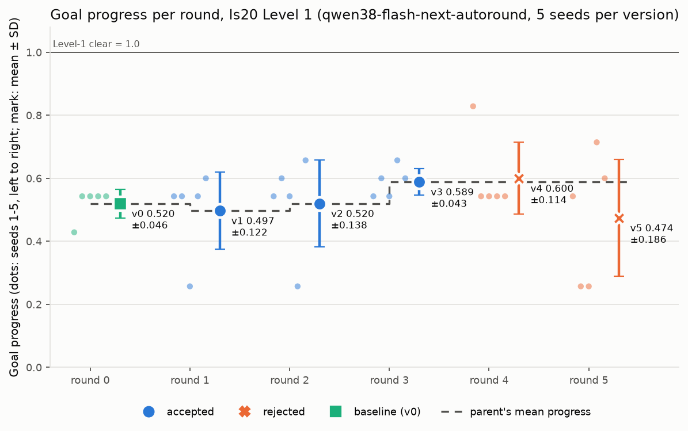
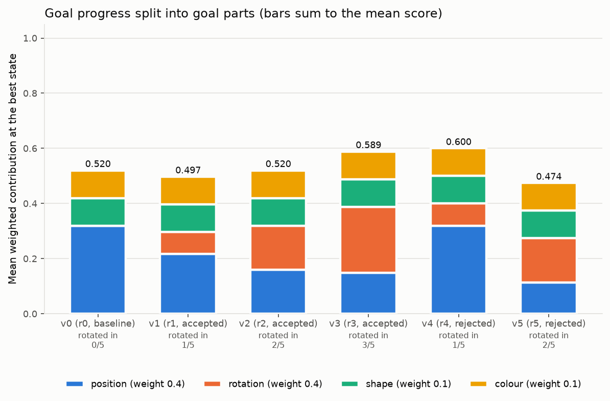
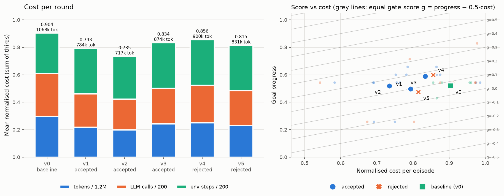
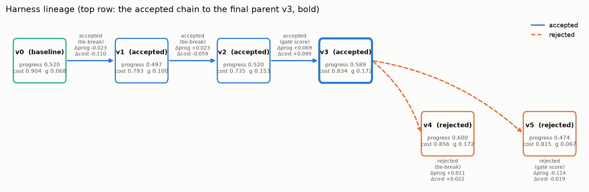
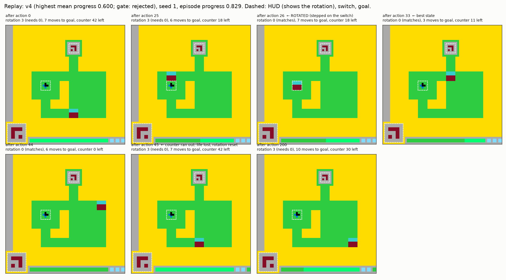
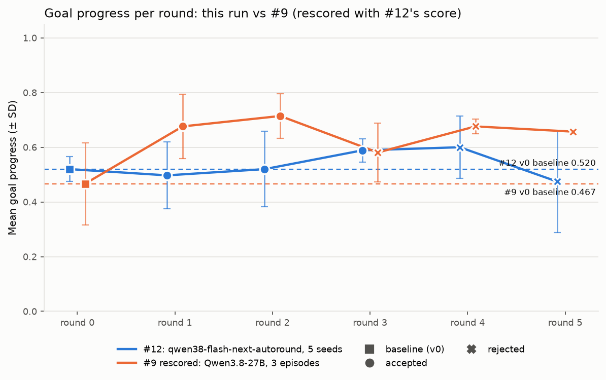

# Report: #12 — evo-harness v2 on ls20 Level 1 with qwen38-flash-next-autoround

Branch `experiment/12-evo-harness-v2-ls20` · 5 rounds complete (v0 → v5) · 30 counted episodes, seeds 1–5 for every version

## Summary

- **No version cleared Level 1** (0/30 episodes).
- **Final parent v3:** goal progress **0.589 ± 0.043**, against v0's 0.520 ± 0.046.
  - 3/5 of v3's episodes rotated; none of v0's did.
  - v3 is also cheaper than v0 (cost 0.834 vs 0.904).
- **Gate decisions:**
  - v1 and v2 were accepted on the **cost tie-break** (same progress within ε, cheaper);
  - v3 was accepted on **gate score** (more progress, though more expensive);
  - v4 was rejected (a tie on progress, and not cheaper);
  - v5 was rejected (less progress).
- **The new score shows what #9's could not.** In 24/30 episodes the player reached the square under the goal **with the wrong rotation**. It then pushed into the goal a total of 659 times. 55% of all moves were blocked and went nowhere.
- **The best episode was 3 moves from clearing and walked away** (v4 seed 1, progress 0.829, see the replay).
- **The fact-check dropped 6 edits for false game claims.** Among them: "the target is the blue/black sprite" (that's the rotation switch, the same mistake #9's score made), "cyan is the target", and "ACTION5/7 rotates the player".
  - It also missed some: extraction is inconsistent, and a promoted helper that mislocates the player got through.
- **Promotion fired** under the lower thresholds:
  - 3 helpers became skills;
  - one (`teal_centroid`) was reused heavily;
  - one was never used and the 10-episode delete rule removed it;
  - one (`get_cluster_centroid`) is wrong and was used anyway.
- **The three comparisons:**
  - the model change alone raised progress (+0.053) but made play much costlier (+0.359);
  - the evolve loop added +0.080;
  - **#9's best (rescored, 0.714) is still above this run's best (0.600).**

---

## Pictures

**1 · Goal progress per round** (dots: seeds 1–5; large mark: mean ± SD; colour *and* shape give the gate decision; dashed line: the parent's mean).

**2 · Goal progress split into goal parts.** Each bar is the mean weighted contribution at each episode's best state, so a bar sums to the mean score. Shape and colour already match at the start; the differences are rotation (orange) and position (blue).

**3 · Cost per round, and goal progress vs cost per version.** Grey lines are equal gate score, g = progress − 0.5·cost.

**4 · Harness lineage v0 → v5**, with the gate decision and the rule that decided it on each edge.

**5 · Episode replay from the best version: v4, seed 1.** v4 had the highest mean progress (0.600), though the gate rejected it on cost. Key frames show the rotation step, the best state, and the life loss that undid it. The HUD box at the bottom left shows the player's rotation. GIF: [replay_v4_seed1.gif](results/evolve_12/figures/replay_v4_seed1.gif).

What it shows:
- **Action 26:** the player steps on the switch, so its rotation now matches the goal. But 24 of this life's 42 moves are already spent.
- **Action 33:** it is **directly below the goal, rotated, with 11 moves left**. Three ACTION1 presses would have cleared the level.
- **It goes right instead,** then presses into a wall until the counter runs out (action 44).
- **Action 45:** losing a life puts the player back at the start and resets its rotation. It then walks back under the goal with the wrong rotation, the usual dead end.

**6 · This run vs #9**, with #9's episodes rescored on #12's scale and both v0 baselines marked.

---

## The goal-progress score (change 1)

It reads ls20's own state after every action. That state is logged in the trajectory as `game_state` and is never visible to the player. The score combines every condition the game checks before it clears Level 1 (`bejndxqqzf` + `pbznecvnfr` in the game source). Each state scores Σ weight·part; an episode scores its **best** state; a clear = 1.0.

| part | weight | value |
|---|---|---|
| position | 0.4 | 1 − (maze moves to the goal) / 7, where 7 is the distance from the start |
| rotation | 0.4 | 1 if the player's rotation index equals the goal's (needs 0, starts at 3; changed only by stepping on the switch) |
| shape | 0.1 | 1 if the shape index matches (it does from the start on Level 1) |
| colour | 0.1 | 1 if the colour index matches (it does from the start on Level 1) |

Landmarks: start 0.200 · under the goal with the wrong rotation 0.543 · rotated, at the switch 0.600 · rotated, under the goal 0.943 · clear 1.000. Scoring the best *joint* state means "rotated at one time, near the goal at another" earns only the better of the two. #9's 18 episodes were rescored the same way, by deterministic replay of their logged actions (`results/evolve_12/rescored_9.json`).

## Tables

### Per round

| round | version | parent | mean progress (± SD) | clear rate | avg steps | avg cost | avg tokens | gate score | decision | reason |
|---|---|---|---|---|---|---|---|---|---|---|
| 0 | v0 | – | 0.520 ± 0.046 | 0/5 | 177 | 0.904 | 1068k | 0.068 | **baseline** | v0 is the starting parent |
| 1 | v1 | v0 | 0.497 ± 0.122 | 0/5 | 200 | 0.793 | 784k | 0.100 | **accepted** | tie on progress (\|-0.0228\| <= eps 0.05); child cheaper (cost -0.1103); drop +0.0848 <= 0.1 |
| 2 | v2 | v1 | 0.520 ± 0.138 | 0/5 | 187 | 0.735 | 717k | 0.153 | **accepted** | tie on progress (\|+0.0228\| <= eps 0.05); child cheaper (cost -0.0587); drop +0.0288 <= 0.1 |
| 3 | v3 | v2 | 0.589 ± 0.043 | 0/5 | 200 | 0.834 | 874k | 0.172 | **accepted** | gate-score gain +0.0190 > 0 and drop -0.1680 <= 0.1 |
| 4 | v4 | v3 | 0.600 ± 0.114 | 0/5 | 200 | 0.856 | 900k | 0.172 | **rejected** | tie on progress (\|+0.0114\| <= eps 0.05); child not cheaper (cost +0.0217) |
| 5 | v5 | v3 | 0.474 ± 0.186 | 0/5 | 198 | 0.815 | 831k | 0.067 | **rejected** | no gate-score gain (-0.1047; progress -0.1143, cost -0.0191) |

### Per seed (goal progress)

| version | seed 1 | seed 2 | seed 3 | seed 4 | seed 5 | mean |
|---|---|---|---|---|---|---|
| v0 (baseline) | 0.429 (pos,rot) | 0.543 (pos,rot) | 0.543 (pos,rot) | 0.543 (pos,rot) | 0.543 (pos,rot) | 0.520 |
| v1 (accepted) | 0.543 (pos,rot) | 0.543 (pos,rot) | 0.257 (pos,rot) | 0.543 (pos,rot) | 0.600 (pos) | 0.497 |
| v2 (accepted) | 0.543 (pos,rot) | 0.600 (pos) | 0.543 (pos,rot) | 0.257 (pos,rot) | 0.657 (pos) | 0.520 |
| v3 (accepted) | 0.543 (pos,rot) | 0.600 (pos) | 0.543 (pos,rot) | 0.657 (pos) | 0.600 (pos) | 0.589 |
| v4 (rejected) | 0.829 (pos) | 0.543 (pos,rot) | 0.543 (pos,rot) | 0.543 (pos,rot) | 0.543 (pos,rot) | 0.600 |
| v5 (rejected) | 0.543 (pos,rot) | 0.257 (pos,rot) | 0.257 (pos,rot) | 0.714 (pos) | 0.600 (pos) | 0.474 |

(in brackets: goal parts failing at the episode's best state; pos = position, rot = rotation)

### Edits per round

| round | child | promote | merge | delete | edit | add (other) | from Meta LLM | rule-based | dropped at Validate (stage) |
|---|---|---|---|---|---|---|---|---|---|
| 1 | v1 (accepted) | 2 | 0 | 0 | 1 | 1 | 2 | 2 | 3 (replay 1, fact-check 2) |
| 2 | v2 (accepted) | 0 | 0 | 1 | 2 | 0 | 2 | 1 | 2 (skill test 2) |
| 3 | v3 (accepted) | 1 | 0 | 1 | 2 | 0 | 2 | 2 | 2 (fact-check 1, static tests 1) |
| 4 | v4 (rejected) | 0 | 0 | 0 | 2 | 1 | 3 | 0 | 1 (fact-check 1) |
| 5 | v5 (rejected) | 0 | 0 | 0 | 1 | 0 | 1 | 0 | 3 (skill test 1, fact-check 2) |

Accepted edits, by round:

- v1 `r1-e2` [rule] add skill block_info ⚑ unverifiable claims
- v1 `r1-e3` [rule] add skill teal_centroid ⚑ unverifiable claims
- v1 `r1-e5` [meta] add skill move_cluster_to
- v1 `r1-e6` [meta] edit step 4
- v2 `r2-e1` [rule] delete skill bfs_to_target
- v2 `r2-e4` [meta] edit step 4
- v2 `r2-e5` [meta] edit prompt knowledge ⚑ unverifiable claims
- v3 `r3-e1` [rule] add skill get_cluster_centroid ⚑ unverifiable claims
- v3 `r3-e2` [rule] delete skill block_info
- v3 `r3-e5` [meta] edit step 4
- v3 `r3-e6` [meta] edit prompt knowledge ⚑ unverifiable claims
- v4 `r4-e1` [meta] edit skill move_cluster_to ⚑ unverifiable claims
- v4 `r4-e2` [meta] add skill try_rotate ⚑ unverifiable claims
- v4 `r4-e4` [meta] edit step 4
- v5 `r5-e3` [meta] edit skill move_cluster_to ⚑ unverifiable claims

### Helpers

| version | helper groups written (distinct bodies) | episodes that wrote one | helper calls | promoted into this version | promoted skills called by its players |
|---|---|---|---|---|---|
| v0 | 28 | 4/5 | 92 | – | – |
| v1 | 1 | 1/5 | 0 | block_info, teal_centroid | block_info (0 calls), teal_centroid (90 calls) |
| v2 | 1 | 1/5 | 4 | – | block_info (0 calls), teal_centroid (191 calls) |
| v3 | 1 | 1/5 | 0 | get_cluster_centroid | teal_centroid (258 calls), get_cluster_centroid (94 calls) |
| v4 | 2 | 1/5 | 6 | – | teal_centroid (118 calls), get_cluster_centroid (135 calls) |
| v5 | 5 | 3/5 | 8 | – | teal_centroid (156 calls), get_cluster_centroid (107 calls) |

### Fact-check

| round | claims tested | true | false | unverifiable | edits dropped for a false claim | extraction calls / tokens |
|---|---|---|---|---|---|---|
| 1 | 33 | 21 | 5 | 7 | 2 (r1-e4, r1-e7) | 1 / 5.2k |
| 2 | 5 | 4 | 0 | 1 | 0 (–) | 1 / 3.5k |
| 3 | 12 | 6 | 1 | 5 | 1 (r3-e3) | 1 / 3.8k |
| 4 | 15 | 9 | 1 | 5 | 1 (r4-e3) | 1 / 2.7k |
| 5 | 19 | 10 | 5 | 4 | 2 (r5-e2, r5-e4) | 1 / 4.0k |
| **all** | **84** | **50** | **12** | **22** | **6** | 5 / 19.3k |

Claims labelled false (the evidence is the game's ground truth; the Meta LLM was told only that the claim is false):

- round 1 `r1-e4` (edit prompt knowledge): "The goal is to move the cluster into a target region (often a grey(5) box or near the blue(1)/black(0) sprite at rows 31-33, cols 20-22)." → blue is rotation_switch; black is rotation_switch; goal at rows 10-14, cols 34-38
- round 1 `r1-e7` (edit step 1): "Identify the teal/maroon cluster centroid and the target location (grey box or blue/black sprite)." → blue is rotation_switch; black is rotation_switch
- round 3 `r3-e3` (add skill analyze_cluster_state): "'target': (row, col) of the nearest cyan(8) or grey(5) target" → cyan is lives
- round 4 `r4-e3` (edit prompt knowledge): "try_rotate() to find the action that flips it (likely ACTION5 or ACTION7)" → no action rotates the player directly; rotation switch at rows 30-34, cols 19-23
- round 5 `r5-e2` (add skill try_rotate_cluster): "Try ACTION5 and ACTION7 to rotate the cluster" → no action rotates the player directly; rotation switch at rows 30-34, cols 19-23
- round 5 `r5-e4` (edit prompt knowledge): "likely ACTION5 or ACTION7" → no action rotates the player directly; rotation switch at rows 30-34, cols 19-23
- round 5 `r5-e4` (edit prompt knowledge): "Identify target location (cyan/grey box)" → cyan is lives

## Main failure modes (all 30 episodes; `results/evolve_12/failure_modes.json`)

| | count |
|---|---|
| moves that were **blocked** (player didn't move, but the 42-move counter still ticked) | **3,219 of 5,811 (55%)** |
| episodes that reached the square under the goal **with the wrong rotation** | **24 / 30** |
| ACTION1 presses into the goal from there (it blocks a wrongly rotated player) | **659** (up to 56 in one episode) |
| episodes that ever matched the goal's rotation | 9 / 30 (6 of them only after action 130) |
| episodes that got within 3 moves of the goal while rotated | 1 (v4 seed 1) |
| episodes where a lost life undid the rotation | 3 |

1. **The goal looks like a wall.** The player reaches the square under the goal, presses ACTION1, nothing happens, and it keeps pressing (#9's failure). The goal parts make it visible: "position 0.86, rotation WRONG" is the commonest best state in every version.
2. **Blocked moves drain the counter.** Over half of all moves go nowhere, and each costs one of the 42 moves a life allows. The players never act as though they know this.
3. **Rotation and the walk to the goal must happen within one life.** Losing a life resets the rotation, so rotating with only a few moves left is wasted. Most rotations happened late (6 of 9 after action 130), and some with 2–16 moves left on the counter.
4. **Nobody connected "rotated" with "now go to the goal".** The best episode got within 3 moves while rotated and then left (picture 5).
5. **The Meta LLM's false beliefs persisted.** It proposed "cyan is the target" and "ACTION5/7 rotates the player" in rounds 3–5. The fact-check dropped them (except once), but the Meta LLM never found the real cause of rotation.

## What each of the four changes did

**1 · Goal-progress score.**
- It is deterministic, from game state. It includes rotation. Logged states equal replay-rebuilt states (self-test, and a 200-action stub episode with game overs).
- It turned #9's flat 0.474 plateau into a readable split between position and rotation.
- Rescored, #9's v2 (0.714) still beats every #12 version: its 3 episodes all rotated.

**2 · Fact-check in Validate.** 84 claims tested: 50 true, 12 false, 22 unverifiable; 6 edits dropped for a false claim.
- **Caught:**
  - the rotation switch called "the target" (round 1, two edits);
  - cyan called "the target" (rounds 3, 5);
  - "ACTION5/7 rotates the player" (rounds 4, 5).
  - Tested offline on #9's own edits, it also marks the lime-bar player, 1-cell moves, collect-maroon, cyan-hazard and green-trail claims false.
- **Missed:**
  1. *Inconsistent extraction.* Round 4's `try_rotate` ("Try ACTION5 and ACTION7 to find which one rotates the cluster") passed as unverifiable. Round 5's near-identical `try_rotate_cluster` was dropped as false. v4's players therefore saw a false docstring, though they never called the skill.
  2. *Skill outputs.* `get_cluster_centroid(g, …)` averages teal **and maroon** cells; maroon is also in the HUD and the goal. On recorded states it returns a column around 22–25 while the player is at columns 34–43. The output check calls skills with no arguments, so it could not run this one, and the extractor described its claims too vaguely.
  3. *"Unverifiable" is often "described vaguely".* The correct `teal_centroid` also came out unverifiable.
- **By design, the Meta LLM is told only that a claim is false.** It re-proposed the same false rotation belief in three rounds.

**3 · Lower promotion thresholds.** Promotion never fired in #9. Here it promoted 3 helpers, each written once by one player:

| helper | promoted in | status |
|---|---|---|
| `teal_centroid` | v1 | **correct**; called 90–258 times per version afterwards |
| `block_info` | v1 | never called; **deleted in round 3** by the 10-episode rule, the issue's safeguard working as intended |
| `get_cluster_centroid` | v3 | **wrong**; called 94–135 times per version |

After promotion, players stopped writing their own helpers (v0: 28 helper groups; v1–v4: 1–2). The risk the issue named happened once and wasn't caught.

**4 · Cost-aware gate and 5 seeded parallel episodes.**
- Two of three acceptances came from the tie-break. They cut cost from 0.904 to 0.735 at the same progress: fewer turns and tokens for 200 actions.
- With n = 5 and per-version SD up to 0.19, |Δprogress| ≤ 0.05 was the common case (3 of 5 gates).
- The cost penalty never stopped a version that progressed (v3 was costlier and accepted).
- v4 shows the gate judges the mean: it had the best episode of the run (0.829), but 4 stalled episodes.
- All 30 episodes ran in parallel 5 at a time, each with its own env, sandbox and client. A self-test confirms parallel and serial envs produce identical frames.

## The three comparisons (from "Model change and baseline")

| comparison | from | to | Δ progress | Δ cost | what it measures |
|---|---|---|---|---|---|
| #9 v0 (rescored) → #12 v0 | 0.467 ± 0.150 (cost 0.545, g 0.194) | 0.520 ± 0.046 (cost 0.904, g 0.068) | +0.053 | +0.359 | the model change alone (same v0 harness; 3 vs 5 episodes) |
| #12 v0 → #12 best (v4) | 0.520 ± 0.046 (cost 0.904, g 0.068) | 0.600 ± 0.114 (cost 0.856, g 0.172) | +0.080 | -0.048 | the evolve loop on the new model |
| #9 best (rescored, v2) → #12 best (v4) | 0.714 ± 0.081 (cost 0.546, g 0.441) | 0.600 ± 0.114 (cost 0.856, g 0.172) | -0.114 | +0.309 | model + harness changes together |

"Best" = highest mean goal progress (ties → higher gate score). #12's final parent (what the gate kept) is v3; #9's was v2.

## Run notes and deviations

- **ε = 0.05, not 0.5**, chosen by you before the run. With 0.5 almost every comparison would have been a tie.
- **Cost** = mean of tokens/1.2M, LLM calls/200 and env steps/200. Wall time is recorded but not penalised. Also your choice.
- **Seeds 1–5 change neither ls20 nor the model's sampling**: the frames are identical under every seed, and the endpoint ignores `seed`. A seed names an attempt.
- **Wall clock 90 min → 4 h, with a restart from round 0.** In the first attempt, 4/5 v0 episodes were cut by the 90-min cap at 123–136 actions, because 5 parallel episodes slow the endpoint to ~40 s per turn. You chose to raise the cap and restart; the first attempt is kept in `data/` only.
  - Two fact-check parsing bugs were also found in that attempt (nested fields, colour indices) and fixed before the restart.
- **Paused 3 times at your request** (after round 0, in round 2, in round 3). Each resume reused the saved stages; only the interrupted evaluations were replayed.
- **Tokens:**
  - 25.87M player tokens over the 30 counted episodes, plus 0.11M for the Meta LLM and fact-check.
  - About 7.8M more outside the counted results: the first attempt's round 0 (3.42M), the two cut-short evaluations (v3: 2.52M; v2: ≈1.8M), and the pilot (0.08M).
  - About 34M in all, under the 40M cap.
- The detached run's redirected stdout twice stopped receiving progress lines while the run itself was fine. Progress now also goes to `data/evolve_12_events.log`.

## Recommended next steps

1. **Make the fact-check consistent on code:**
   - extract the same claim types from docstrings as from prose;
   - retry skill-output checks with `grid()` as the argument;
   - add a "returns the player position" claim for any locate-the-player helper.

   That would have caught `try_rotate` and `get_cluster_centroid`.
2. **Tell the player what blocked moves cost.** Add an observation line with the counter, or a fact-checked knowledge line saying "a move into a wall still uses the counter; when it runs out you lose a life and your rotation resets". This attacks failure modes 2–3 directly.
3. **More episodes, or paired comparisons, before trusting the tie-break.** At n = 5, most gates were ties decided on cost.
4. **Let the Meta LLM see *why* a claim is false**, or add a "how does rotation change?" probe to Analyze. Its false rotation belief survived three rounds of "contradicted by the game".

## Paths

| what | path |
|---|---|
| every version, score, cost, seed and gate decision | `results/evolve_12/archive.json` |
| edits by round, with fact-check flags | `results/evolve_12/CHANGELOG.md` |
| harnesses v0–v5 (final parent v3) | `results/evolve_12/harnesses/` |
| per-round analysis, proposals, Validate (incl. every fact-checked claim), episodes | `results/evolve_12/reports/round_N/` |
| trajectories (`seed_S.jsonl`, with `game_state` and per-turn cost) and frames | `results/evolve_12/trajectories/`, `results/evolve_12/frames/` |
| figures | `results/evolve_12/figures/` |
| report tables, failure modes, #9 rescored | `results/evolve_12/report_tables.md`, `failure_modes.json`, `rescored_9.json` |
| code | `evolve/goal_score.py`, `evolve/factcheck.py`, `evolve/score.py`, `evolve/loop.py`, `analysis/evolution12.py`, `analysis/report12.py`, `analysis/failure_modes12.py`, `analysis/rescore_9.py` |
| step-by-step process | `WORK_LOG-12.md` |
