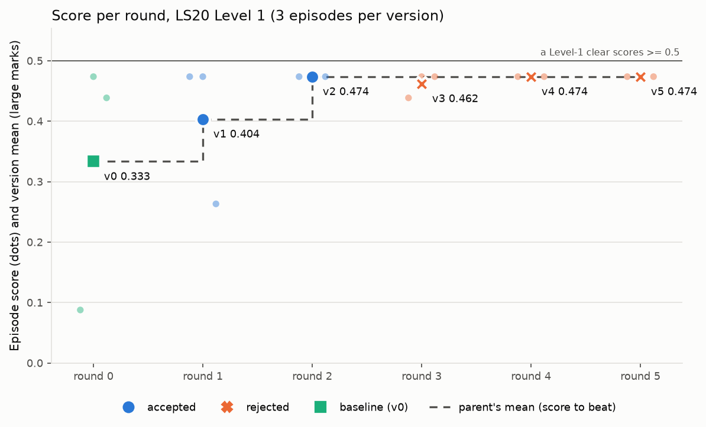
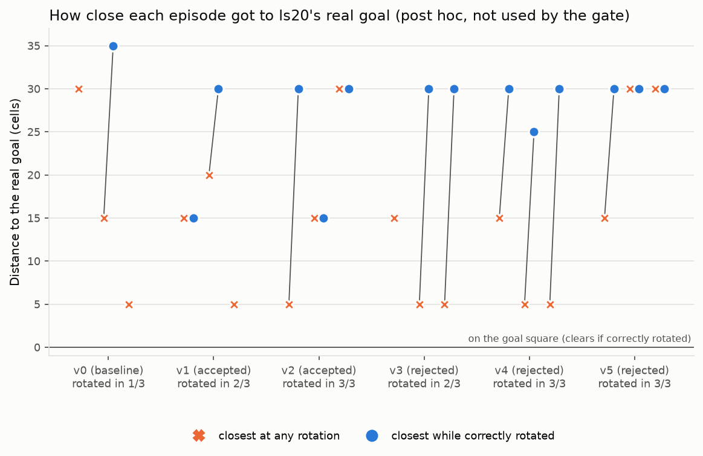
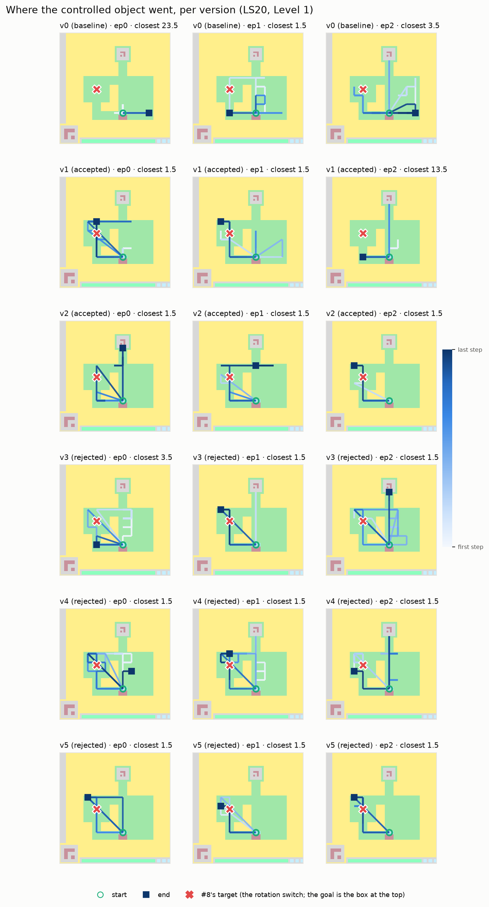

# Issue #9: evo-harness architecture and problems

Branch `experiment/9-evo-harness-ls20` · PR #11 · run on 2026-11-01

## 1. Summary

- We ran a self-improving game-playing agent for **5 rounds** on ARC-AGI-3 game **ls20, Level 1**. The player model was `Qwen/Qwen3.8-27B-FP8`.
- **No version cleared Level 1** (0 of 18 episodes).
- The score went up from v0 = 0.333 to v2 = 0.474, but **that gain is misleading**. The score measured distance to the wrong object: the rotation switch instead of the goal.
- **Mechanically, the architecture worked.** The sandbox, replay, Validate, gate and resume all did their jobs, and caught the 2 broken edits.
- **The problems are in what it optimised and what it can check.** The score pointed at the wrong target, Validate cannot tell a true claim about the game from a false one, Analyze gave the Meta LLM misleading evidence, and the gate is too weak with only n=3 episodes.

---

## 2. Architecture

### 2.1 The big picture

```
                         ┌──────────────────────────────────────────────┐
                         │  evolve_run.py  (driver)                      │
                         │  preflight · pilot · run · figures · stub      │
                         │  creds from QWEN_API_KEY / QWEN_BASE_URL       │
                         └───────────────────────┬──────────────────────┘
                                                 │
                                    evolve/loop.py  run()
                                                 │
   round 0:  build v0 (seed_v0.py) ──► evaluate v0 (3 episodes) ──► archive.json
                                                 │
   round N:  parent = last accepted version
             │
             ├─ 1 · Analyze   (analyze.py)   parent's trajectories+frames ─► analysis.json
             ├─ 2 · Propose   (propose.py)   rule edits + Meta LLM edits  ─► proposals.json
             ├─ 3 · Validate  (validate.py)  apply · static · load · replay · merge-eq · skill test
             │                                                             ─► validation.json
             ├─ 4 · Write vN  (harness.py, edits.py)   harnesses/vN/ + CHANGELOG.md
             ├─   evaluate vN (action_loop.py + sandbox.py, 3 episodes in parallel)
             │                                                             ─► episodes.json
             └─ 5 · Gate      (score.py)   gain > 0 and worst-drop ≤ 0.1   ─► archive.json
                                           accepted → vN becomes parent
                                           rejected → parent stays
```

Every stage writes its output under `results/evolve/reports/round_N/` before the next stage starts. An interrupted run therefore resumes where it stopped, which is what saved us when round 4 was killed for low memory.

### 2.2 What a "harness version" is

A version is a directory, `results/evolve/harnesses/vN/`, holding four kinds of file:

| File | What it holds | Changed by evolution? |
|---|---|---|
| `manifest.json` | the version, its parent and round, and the edits that produced it | n/a |
| `prompts.json` | `system`, `knowledge`, `format` | **only `knowledge`** was ever changed |
| `steps.json` | the 6-step turn procedure (OBSERVE → CHECK → HYPOTHESISE → PLAN → CODE → NOTE) | **never** (identical in v0–v5) |
| `skills/*.py` | one Python function per file, preloaded into the sandbox | yes (added, deleted and edited) |

Everything the player sees is rendered from these files, so two versions differ only in what is on disk.

v0 is #8's harness ported to code-acting (`seed_v0.py`). It keeps #8's rules text, #8's 4 code modules as skills, and #8's mined action rules as the `knowledge` prompt.

### 2.3 One episode: the code-acting player

```
 observation (grid summary, objects with id=N, last cell's output, history, notes)
        │
        ▼
 player LLM  ──► reply: 6 reasoning steps + one ```python cell
        │
        ▼
 sandbox.py:  AST filter (no _attrs, import allow-list, no open/exec/eval, no bare except)
              + builtin whitelist + 10 s cell time limit + persistent namespace
        │
        ▼
 cell calls action(n) ≤ 6 times per turn, calls skills, sets `notes`
        │
        ▼
 EpisodeAPI ──► ls20 environment ──► new frame
        │
        └─► logged: trajectories/round_N/episode_K.jsonl + frames/round_N/episode_K.npz
```

**Episode limits:**
- 200 game actions;
- 200 turns;
- 90 minutes of wall clock;
- 1.2M tokens;
- 10 resets.

**The sandbox is not a security boundary.** It guards against accidents: an infinite loop, a file write, a stray import.

### 2.4 The five meta stages

| Stage | Input | What it does | Output |
|---|---|---|---|
| **1 · Analyze** | the parent's 3 episodes, the archive | Per-skill stats (calls, errors, lifetime use), inline helpers the player wrote itself, what each action did (from #8's movement detector), and common errors. | `analysis.json` |
| **2 · Propose** | the Analyze report and the current harness | **Rules:** promote a helper (≥2 episodes or ≥6 calls), delete an unused skill (≥6 episodes unused), merge identical skills. **Meta LLM:** up to 4 semantic edits on skills, prompts and steps. Each edit is tagged `rule` or `meta`. | `proposals.json` |
| **3 · Validate** | the proposals | Tries each edit in order and keeps it only if it applies, passes the static checks, loads, **replays the parent's episodes exactly** (skills only), is merge-equivalent, and passes its skill test. | `validation.json` |
| **4 · Write** | the surviving edits | Writes `harnesses/vN/` and adds an entry to `CHANGELOG.md`. | the vN directory |
| **5 · Gate** | the 3 vN episodes and the parent's | Accepts if mean gain > 0 **and** the worst episode drops by at most 0.1. A tie is rejected. | `archive.json` |

**Replay** (`replay.py`) is what makes Validate strong for code. ls20 is deterministic and seed-independent, so re-running the logged cells under the edited harness shows exactly which turns an edit changed.

### 2.5 The score

```
cleared:      0.5 + 0.5 · min(1, 22 / actions)²        (22 = human baseline)
not cleared:  0.5 · progress,   progress = max(0, 1 − closest / start)
```

`closest` and `start` come from #8's `analysis/approach.py`. **The object that code measures to is the problem described in §4.1.**

### 2.6 Files at a glance

```
evolve_run.py           driver
config_evolve.yaml      all settings (no credentials)
evolve/
  loop.py               the rounds, resume logic, archive and changelog
  action_loop.py        EpisodeAPI, run_episode, observation formatting
  sandbox.py            restricted exec for the player's cells and skills
  harness.py            the version format, API_DOC shown to the player
  seed_v0.py            builds v0 from #8
  analyze.py · propose.py · validate.py · edits.py · score.py · replay.py
  selftest.py · stub.py offline end-to-end test (no model calls)
analysis/
  evolution.py          figures from archive.json (reuses #8's figure code)
  ls20_subgoals.py      post-run check against ls20's REAL goal
results/evolve/         archive.json, CHANGELOG.md, harnesses v0–v5, reports,
                        trajectories, frames, figures, subgoals.json
```

---

## 3. What happened

| Round | Version | Parent | Clears | Mean | Worst | Gate | Player tokens |
|---|---|---|---|---|---|---|---|
| 0 | v0 | – | 0/3 | 0.333 | 0.088 | baseline | 1.01M |
| 1 | v1 | v0 | 0/3 | 0.404 | 0.263 | **accepted** | 0.90M |
| 2 | v2 | v1 | 0/3 | 0.474 | 0.474 | **accepted** (best) | 1.07M |
| 3 | v3 | v2 | 0/3 | 0.462 | 0.439 | rejected | 0.81M |
| 4 | v4 | v2 | 0/3 | 0.474 | 0.474 | rejected (tie) | 3.05M |
| 5 | v5 | v2 | 0/3 | 0.474 | 0.474 | rejected (tie) | 0.95M |

**Edits across the run:**
- 14 were proposed: 13 by the Meta LLM and 1 by the rules.
- 12 passed Validate: 5 add, 1 delete, 6 edit, 0 merge.
- 6 of those ended up in accepted versions.

**The 2 dropped edits:**
- `r3-e2` raised a `TypeError` on replay.
- `r4-e3` deleted a skill that v2 still used.

**Measured afterwards against the real goal** (`analysis/ls20_subgoals.py`):
- 14 of 18 episodes reached the right rotation.
- 7 of 18 reached the square directly under the goal.
- **No episode ever stood on the goal.**





---

## 4. Problems

They are grouped by where they sit in the architecture, most important first.

### 4.1 Score / Gate: the progress term measured the wrong object ⚠ biggest problem

- **What happened:**
  - ls20 Level 1 clears when the player stands on the **grey box at the top** (the goal) **and** holds the goal's rotation.
  - The player starts with rotation 3, and the goal needs rotation 0.
  - The blue/black object near row 32, col 21 is a **rotation switch**.
  - #8's `approach.py` calls that switch "the target", and I reused it as "progress toward the goal" without checking it against the game's rules. You agreed to the formula; choosing that target was my error.
- **Effects:**
  - The score levels off at **0.474** once the player touches the switch. That is why v4 and v5 tied v2 exactly, and a tie is rejected, so evolution stalled.
  - In places it points the wrong way. v0 ep2 and v1 ep2 came **one move from the goal** but scored low (0.439 and 0.263) because they were far from the switch.
  - The gate rewarded the wrong behaviour. v2 is "best" because it reaches the switch every time, not because it is closer to clearing.
- **Fix:** score progress against the goal square **and** the rotation. `ls20_subgoals.py` already computes both. Then re-run.

### 4.2 Player behaviour: the goal looks like a wall

- A wrongly rotated player is **blocked** by the goal. Six ACTION1s from the start reach the square below it, and the seventh changes nothing.
- 7 of 18 episodes got there and concluded it was a wall. Their notes say "possible wall" and "Grey wall at row 60 blocks UP. Need to find gap."
- The other half of the puzzle, getting the rotation right, happened mostly by accident: 14 of 18 episodes bumped the switch while wandering.
- **No episode ever combined the two** (rotate first, then go back to the goal).
- **This is the real skill the agent is missing.** No part of the architecture pushes towards it, because the score doesn't reward it (§4.1).

### 4.3 Meta LLM → `knowledge` prompt: false game facts spread through every version

- **The wrong player:**
  - v0 ep2's own notes said "Player=lime".
  - In round 1 the Meta LLM wrote that into `knowledge` ("Player: 2-row lime bar at the bottom") and added a `player_position()` skill that looks for lime cells.
  - **The lime bar is the action counter; the player is the teal block.**
  - Every later version kept and elaborated the mistake, and players adopted it. A v2 player that had moved the teal block right under the goal decided it still needed "to figure out how to actually move the player".
- **The wrong movement rule:**
  - v2's `knowledge` already contradicts itself: "Moves 1 cell per action" in one line, and "ACTION1 = move up 5 cells" a few lines later.
  - v4 and v5 pushed the 1-cell claim further. #8's mined rules had precision 1.00 for 5-cell moves.
- **Why the architecture let this through:**
  - `knowledge` is free text, so one bad edit poisons every child.
  - Nothing checks it against the recorded game data (§4.4).
  - An accepted version is never re-examined, so the wrong belief was inherited permanently.

### 4.4 Validate checks mechanics, not truth

- **It works for code.** Replay caught both broken edits: a crash, and the deletion of a skill still in use.
- **It is blind for text.** Prompt and step edits can't be replayed without a model, so they only get size and format checks.
- Because Validate can't tell a true claim about the game from a false one, §4.3 went straight through. The only remaining filter is the gate, and with n=3 and a score that levels off, the gate is weak.
- **Fix:** check factual claims written into `knowledge` against recorded transitions. For example, test "ACTION1 moves the player 1 cell" on the saved frames, and drop the edit if the data contradicts it.

### 4.5 Analyze: misleading evidence for the Meta LLM

- Every move also drains the lime action counter. #8's rigid-translation detector therefore often fails to classify a clean 5-cell move, and labels many ACTION1 and ACTION3 effects "other change".
- The Meta LLM's own reasoning cites those labels when it writes the 1-cell rule.
- **Fix:** separate the counter's change from the player's move before summarising what each action does.

### 4.6 Gate: too weak with n = 3

- **Sample size:** 3 episodes of one deterministic level are 3 temperature-0.2 samples, so mean gains of ±0.07 are within noise.
- **Ties:** combined with the level-off, ties are guaranteed (v4 and v5 were both exact ties), and a tie is rejected.
- **Cost:** the gate never sees what a version costs. v4 used 3× the tokens and still tied.
- **Possible fixes:**
  - more episodes per version;
  - a finer-grained progress signal;
  - cost as a tie-breaker or a penalty.

### 4.7 Propose: the rule-based side almost never fires

- **Promote** never fired. Each round had at most one inline-helper group, with 2 calls, against a threshold of ≥2 episodes or ≥6 calls.
- **Merge** never fired, because no two skills had identical bodies.
- **Delete** fired once (`bfs_to_target`).
- **The result:** 13 of 14 edits came from the Meta LLM, which is exactly the source Validate can't check.
- **Steps were never evolved.** `steps.json` is identical in v0–v5, so the turn procedure, one of the three things the harness is meant to evolve, was never explored.

### 4.8 Cost control: one skill can blow the budget

- v4's `verify_move` was called 501 times and turned play into about one action per turn.
- All three v4 episodes hit the 200-turn or 90-minute cap after only 117–176 actions, and cost 3.05M tokens (about 3× any other version).
- Validate checks that a skill is correct, not what it costs. **Fix:** add a cost check to Validate or the gate (tokens or turns per action).

### 4.9 Operational issues (all handled)

| Issue | Effect | Handling |
|---|---|---|
| `objects()` dropped the `id` field that the observation shows | the player's code crashed (KeyError) in the pilot | fixed in e913b64 before any counted episode |
| Claude Code was killed for low memory in round 4 | about 1.2M tokens of v4 play lost | resumed from saved state; only v4's episodes were re-run |
| one refused connection to `three.arcprize.org` | none | `arc_agi` fell back to the identical cached game |
| player called `ACTION6`/`ACTION7`, which ls20 doesn't offer | no cost | ignored |
| 12 reply-format failures (8 of them in v4) | wasted turns | the retry path handled them |

---

## 5. What worked

- **Deterministic replay.** It is exact for ls20, and it caught every broken skill edit.
- **Resumable stages.** Every stage persists to disk, so the low-memory stop cost only v4's episodes.
- **The sandbox.** It had no escapes and no stuck cells; the per-cell time limit and the action cap held.
- **Edit tagging and the archive.** Every edit can be traced to its source (rule or Meta), to the round, and to the gate decision.
- **Self-test.** `python -m evolve.selftest` runs the whole loop offline with no model calls.
- **Credential handling.** Credentials come only from environment variables, the driver redacts them, and a scan of the results and logs found no secrets.

---

## 6. Recommended next steps (in priority order)

1. **Fix the score.** Measure progress against the real goal, including the rotation, then re-run. Without this, nothing else can be judged.
2. **Check `knowledge` edits against data.** Validate should test factual claims on recorded transitions.
3. **Fix Analyze's action-effect summary** so the counter bar doesn't hide 5-cell moves.
4. **Strengthen the gate:** more episodes per version, plus cost as a tie-breaker or penalty.
5. **Give steps and rules a real chance to fire.** Lower the promote thresholds, or let the Meta LLM propose step edits more often.
6. **Optionally re-audit accepted beliefs:** let Analyze flag `knowledge` lines that the parent's own trajectories contradict.

---

## 7. Where to look

| What | Path |
|---|---|
| Every version, score and gate decision | `results/evolve/archive.json` |
| Edits by round | `results/evolve/CHANGELOG.md` |
| Harness files | `results/evolve/harnesses/v0` … `v5` (best: `v2`) |
| Per-round analysis, proposals, validation and episodes | `results/evolve/reports/round_N/` |
| Trajectories and frames | `results/evolve/trajectories/`, `results/evolve/frames/` |
| Real-goal check | `results/evolve/subgoals.json`, `python -m analysis.ls20_subgoals` |
| Step-by-step process | `WORK_LOG-9.md` |
| Full report | issue #9 comment: https://github.com/Paier05/Final-Year-Project/issues/9#issuecomment-6560016696 |
