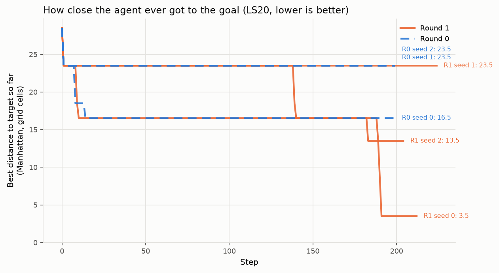
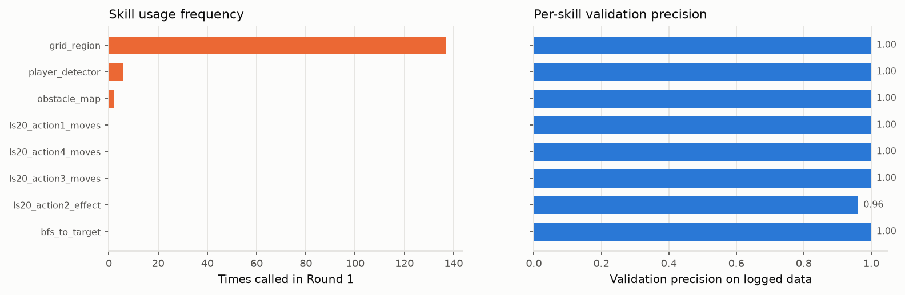

# ARC-AGI-3 Level 1: Qwen3.8-27B + a minimal harness, with skills mined from play

**Issue:** [#8](https://github.com/Paier05/Final-Year-Project/issues/8)
**Branch:** `experiment/8-arc-agi3-level1-skill-learning`
**Status:** Round 0 and Round 1 complete **on one game (`ls20`), 3 seeds each**.
The full 25-game sweep the issue specifies has **not** been run — see
[§1 Scope](#1-scope-what-was-actually-run).

> Every table and figure below is produced by `analysis/`, never typed by hand.
> Run `python run.py --stage analyse` and `python -m analysis.approach` to
> regenerate them from `results/episodes.jsonl`.

---

## 1. Scope: what was actually run

The issue asks for every public game × 3 seeds × 2 rounds. **That is not what
this report covers.** Measured cost for the full specification was ~78M tokens
and ~51 hours sequential, so the user scoped it down to a single game.

| | Issue specifies | Actually run |
|---|---|---|
| Games | 25 public | **1** (`ls20-9607627b`) |
| Seeds | 3 | 3 ✅ |
| Rounds | 0 and 1 | 0 and 1 ✅ |
| Level | 1 only | 1 only ✅ |
| Episodes | 150 | **6** |

`ls20` was chosen over the alphabetically-first game (`ar25`) deliberately:
`ar25` is in the **test** split, and mining skills from a test game is forbidden
by the experiment design, which would have made Round 1 impossible.

**The consequence, stated plainly: this is an in-sample result.** Skills were
mined from `ls20` and re-tested on `ls20`. It measures whether the mined-skill
*mechanism* functions, **not** whether skills generalise. The issue's actual
claim — "the test split is the real result" — remains **untested**. Nothing in
§4 should be read as evidence of generalisation.

---

## 2. Headline result

**Level 1 solve rate: 0/3 in Round 0, 0/3 in Round 1.** Neither configuration
solved `ls20` Level 1 within 200 actions. The human baseline is 22 actions.

Because solve rate is 0 in both rounds, it cannot distinguish them. The graded
version of the same question — *how close did the agent ever get to the goal?* —
does distinguish them clearly.

### Closest approach to the target (Manhattan cells, lower is better)

| Seed | Round 0 | Round 1 | Change |
|---|---|---|---|
| 0 | 16.5 | **3.5** | −13.0 |
| 1 | 23.5 | 23.5 | 0.0 |
| 2 | 23.5 | **13.5** | −10.0 |
| **Mean** | **21.2** | **13.5** | **−7.7** |



Two observations the figure makes unavoidable:

1. **Round 0 never improved after step ~16.** On seeds 1 and 2 the closest the
   agent ever got was at **step 1** — the starting position. Over 200 actions it
   moved away from the goal and never returned. The baseline is not merely
   failing to solve; it is failing to make any progress at all.
2. **Round 1 improved late.** The drops occur at steps ~140, ~185 and ~191 —
   seed 0 was still actively converging when the action budget ended, at 3.5
   cells from the target.

**But the effect is inconsistent.** Seed 1 showed zero improvement. With n=3 on
a single game, the honest summary is: *a large improvement on 2 of 3 seeds, no
effect on the third, in-sample.* That is a promising signal, not a result.

---

## 3. Why Round 0 failed: a diagnosable, specific error

This is the most useful finding, and it is concrete rather than a vague "the
model was not good enough".

The Round 0 agent **inferred the wrong axis for two of four actions**, then
committed to a plan that could not terminate. Its own final scratchpad, seed 0:

> *"ACTION1=up, ACTION2=LEFT (moves bands left 1 col), ACTION3=RIGHT, ACTION4=up.
> Need to move bands LEFT ~14 more cols. Plan: keep pressing ACTION2 until bands
> reach target cols."*

It then pressed **ACTION2 for 187 of 200 actions (94%)**. Tracking the actual
band position through the logged frames:

```
step  1: ACTION2  teal centroid [45.5, 36.0] -> [40.5, 36.0]   row moved, column did NOT
step  8: ACTION2  teal centroid [40.5, 36.0] -> [35.5, 36.0]   row moved, column did NOT
```

ACTION2 moves the band **vertically**. The column stayed pinned at `36.0`; only
three distinct columns were visited in the entire episode. The agent had
confused rows with columns and **never revised the belief across 187
contradicting observations**.

This is a **perception error that became a planning lock-in**. It is not a
reasoning-capacity failure — the model correctly identified the target, the
mover, and that ACTION5/ACTION7 were inert within 6 steps.

### What the skill library did about it

The miner recovers true geometry from the saved frames, independent of what the
agent believed:

| Action | Round 0 agent's belief | Mined from frames | |
|---|---|---|---|
| ACTION1 | up | up 5 | ✅ agent was right |
| ACTION3 | right | **left 5** | ❌ backwards |
| ACTION4 | up | **right 5** | ❌ wrong axis |

In Round 1 the agent's final notes read:

> *"CONFIRMED: ACTION1=UP5, ACTION2=DOWN5, ACTION3=LEFT1, ACTION4=RIGHT1."*

The misconception was corrected, and the behavioural signature of the failure
disappeared.

---

## 4. Behavioural comparison

| Metric | Round 0 (3 seeds) | Round 1 (3 seeds) |
|---|---|---|
| Solve rate | 0/3 | 0/3 |
| Mean closest approach | 21.2 cells | **13.5 cells** |
| Most-used action share | 94%, 83%, 96% | **60%, 72%, 54%** |
| Unique frames visited | 142, 143, 133 | **195, 136, 191** |
| Module calls | 0 | 13, 25, 5 (**43 total**) |
| Parse failures | **0** | **0** |
| Fallback actions | **0** | **0** |
| Tokens | 1,608,394 | 2,445,907 |
| Wall time | 59 min | 87 min |

The action-share column is the fixation loop quantified: Round 0 spent 83–96% of
its budget on a single action, Round 1 spent 54–72%. Unique frames visited —
a proxy for genuine state-space exploration — rose on the two seeds that
improved and was flat on seed 1, which matches the approach-distance result
exactly.

**Round 1 costs ~52% more tokens** for the same 200 actions, because the skill
library and module outputs enlarge every prompt.

### Skill usage



All 43 module calls went to the code modules; `grid_region` dominated, used to
zoom into the target area and read raw colour indices — a sensible use. Seed 1,
the non-improving seed, made the **most** module calls (25) and had **53
no-change actions**, suggesting it burned budget querying rather than acting.

---

## 5. Three harness bugs this experiment exposed

All three were found by running, not by inspection, and all three would have
corrupted the result if missed.

**1. A dead backend fabricated a complete episode.** The provider's model server
began returning 500s. The harness treated each failure as a one-off, substituted
a random fallback action, and recorded a full 200-action episode as a routine
`solved=0, end_reason=budget_actions` row — with `fallback_actions=200` and zero
tokens. That row would have entered `summary.csv` as a real baseline measurement.
Fixed: 5 consecutive call failures now abort the sweep, and `preflight()` probes
`chat/completions` rather than only `/models` (a valid key does not imply working
inference — they are separate services behind one gateway). Detection time went
from 21 minutes to 3 seconds.

**2. The token cap silently biased the comparison.** Round 1 prompts carry the
skill library, so they cost more per step. With a 600k per-episode cap, Round 1
ended on `budget_tokens` at **154–163 actions** while Round 0 ran a full 200 —
handing Round 1 ~20% less budget than its own baseline. The first Round 1
numbers were invalid and were discarded and re-run.

**3. The wall clock then bound unequally too.** After raising the token cap,
endpoint latency drifted from ~9 s/step to ~18.5 s/step and the 2400 s clock cut
one seed off at 130 actions. Raised to 5400 s and that seed re-run.

**All six episodes in this report terminate on `budget_actions` at exactly 200.**
That was verified, not assumed.

### A fourth bug, in the miner

Round 0 initially produced **zero** translation rules — the one skill kind the
issue names explicitly. Three causes, all real:

- The text diff in a record is **truncated** at `max_diff_cells=40` to bound the
  prompt. `ls20` changes 52 cells per step, so every step looked `truncated` and
  was refused. Translations are now computed from the saved `.npy` frames, which
  are untruncated — which is what they were saved for.
- The detector assumed a **single colour**. `ls20` moves a teal band and a maroon
  band as one piece. Each colour is now measured independently and must agree on
  one offset.
- **Support was inflated by repetition.** The 187-press loop made the rule mined
  from that degenerate state the best-supported rule in the library
  (support=546). Each `(frame, action)` context now counts once per episode.

---

## 6. Model, environment and harness

Unchanged from the design; full detail in the sections below.

| Setting | Value |
|---|---|
| Model | `Qwen/Qwen3.8-27B-FP8` via `https://model.chengqi.uk/v1` |
| temperature / top_p | 0.2 / 0.9 |
| max_tokens | 600 |
| thinking | **off** |
| Budget | 200 actions, 5400 s, 1.2M tokens, 10 resets |

**Why thinking is off**, measured on an identical real `ls20` step:

| | Latency | Output tokens | Format |
|---|---|---|---|
| `reasoning_effort: low` | 22.5 s | 956 | paragraphs of prose, then JSON |
| **off** | **6.1 s** | **180** | JSON as the first token |

3.7× faster, 5× cheaper in output, and better formatted. Qwen3.8-27B overthinks
by default. This setting is why the parse-failure rate across all six episodes
is **0**.

**Why API rather than local vLLM.** The only GPU available is an RTX 3060 Laptop
with 6 GiB VRAM against the issue's own ~16 GiB (4-bit) / ~29 GiB (FP8) figures.
Treated as the issue's "no GPU available" case.

### Environment interface (verified by introspection, not guessed)

```python
arcade = arc_agi.Arcade(arc_api_key="", arc_base_url="https://three.arcprize.org")
env   = arcade.make(game_id, seed=seed)
frame = env.reset()
frame = env.step(action, data=..., reasoning=...)
```

Four facts that shaped the harness:

1. **`GameAction(6)` raises** — members are keyed internally by `(value, kind)`.
   `GameAction.from_id(6)` is the correct accessor. Found by the offline
   self-test before any spend.
2. **`available_actions` is authoritative, `tags` is not** — `ft09` reports
   `[6]` while its `tags` list is empty.
3. **Click coords are frame pixel coords** — scale/offset is `(2, 0, 0)`, so the
   32×32 world maps 1:1 into the 64×64 frame; the agent is told `x, y ∈ 0..63`.
4. **Environments run locally** — `arcade.make()` downloads and executes game
   code, so stepping costs no ARC API calls. Essentially all cost is the model.
   (Noted as third-party code execution; it is the official toolkit's documented
   behaviour.)

### Full system prompt and observation format

Verbatim in `docs/system_prompt.txt` and `docs/example_observation.txt`. Three
hand-testable scenarios are in `docs/try_it_yourself.md` for evaluating the same
prompt against other models.

Perception is plain code, no LLM: grid size, colour histogram, 4-connected
components `{id, colour, bbox, size, centroid}`, and a structured frame diff.
Memory is the last 10 (action, effect) pairs plus a 2000-character scratchpad the
model rewrites each step. Output is strict JSON `{thought, action, args,
scratchpad}`; formatting slips (fences, `<think>` blocks, `col`/`row` aliases)
are tolerated, anything else is a counted parse failure, retried once then
replaced by a random **non-RESET** available action.

---

## 7. Games and split (frozen, unused beyond `ls20`)

25 public games enumerated into `results/games.json`; split seed `20261021`
committed.

- **dev (14):** `bp35, cd82, dc22, ft09, g50t, ka59, lp85, ls20, m0r0, re86, sb26, sp80, tr87, vc33`
- **test (11):** `ar25, cn04, lf52, r11l, s5i5, sc25, sk48, su15, tn36, tu93, wa30`

`EnvironmentInfo.baseline_actions[0]` gives a level-1 human baseline for **all
25 games**, so `min(1, human/agent)²` is defined everywhere and nothing needs
marking N/A. Baselines range 7 (`vc33`) to 71 (`wa30`). `ls20` is 22.

`level_score` is empty in `summary.csv` because no episode solved — the score is
defined only for solves.

---

## 8. Failure-mode breakdown

| Mode | Round 0 | Round 1 |
|---|---|---|
| **Format** | none (0 parse failures, 0 fallbacks) | none |
| **Perception** | **primary** — rows/columns confused for 2 of 4 actions | resolved by mined rules |
| **Dynamics** | wrong for ACTION3/ACTION4 | correct per final scratchpad |
| **Goal** | target correctly identified in all seeds | correctly identified |
| **Planning** | **primary** — 83–96% single-action lock-in, no belief revision | reduced to 54–72%; still budget-limited |

The failure moved *up* the stack: Round 0 failed on perception and planning;
Round 1 failed on planning efficiency alone — it knew what to do and ran out of
actions doing it. Seed 0 needed roughly 10 more actions.

---

## 9. Next steps

1. **Run held-out games.** This is the single most important gap. The issue's
   real claim needs test-split games, and nothing here speaks to it. At ~40 min
   per episode, 2–3 test games × 3 seeds is ~6 hours.
2. **Raise the action budget for `ls20`.** Seed 0 was 3.5 cells away and still
   converging at the cutoff. A 400-action budget would establish whether Round 1
   solves it at all — a cheap, decisive experiment.
3. **Stable object tracking.** Object ids are recomputed by size each step, so
   identity is not preserved. This is the most likely root cause of the
   row/column confusion and is the clearest perception fix.
4. **Charge module calls against a separate budget.** Seed 1 made 25 module calls
   and 53 no-change actions and improved not at all. Modules currently cost a
   turn of thinking but no game action, which may encourage querying over acting.
5. **Mine from successful suffixes.** The macro miner found nothing because no
   episode made progress. With solves it should mine the suffix of solving
   episodes rather than fixed-length windows.

---

## 10. Cost

| | Tokens | Wall time |
|---|---|---|
| Round 0 (3 episodes) | 1,608,394 | 59 min |
| Round 1 (3 episodes) | 2,445,907 | 87 min |
| Discarded runs (dead backend, budget-capped Round 1, re-runs) | ~3.5M | ~3 h |
| **Total** | **~7.5M** | **~5 h** |

No GPU-hours: inference was served by an external API. ARC environments run
locally and cost nothing.

---

## 11. Reproducing

```bash
python -m venv .venv
.venv/Scripts/python -m pip install arc-agi pyyaml pandas matplotlib
echo ARC_MODEL_API_KEY=sk-... > .env
python run.py --stage preflight                      # verify key AND inference
python run.py --round 0 --games ls20-9607627b
python run.py --stage skills                         # mine from dev trajectories
python run.py --round 1 --games ls20-9607627b
python run.py --stage analyse                        # summary.csv + figures
python -m analysis.approach                          # approach-distance figure
```

`--round` is resumable (completed `game, seed` pairs are skipped); add
`--no-resume` to force re-runs. `run.py --stub` exercises the whole pipeline with
a random policy and no model calls.

| Path | Contents |
|---|---|
| `config.yaml` | every model/budget/split setting |
| `harness/` | perception, prompt, model client, parsing, episode loop, logging |
| `learning/` | skill mining, validation, code modules |
| `analysis/` | `summary.csv`, `aggregate.json`, figures |
| `skills/` | one JSON per validated skill + `index.json` |
| `data/trajectories/round<N>/<game>/<seed>.jsonl` | per-step records (gitignored; large) |
| `data/frames/...npy` | raw frames for exact replay (gitignored) |
| `docs/` | verbatim prompt, real observation, hand-test scenarios |

---

## 12. Acceptance criteria

| Criterion | Status |
|---|---|
| Every public game × 3 seeds, both rounds | ❌ **1 of 25 games** — scoped down on cost; reason recorded in §1 |
| Trajectory JSONL + frames saved and replayable | ✅ verified |
| ≥1 validated skill, none mined from test games | ✅ 8 skills; enforced by an assertion in `mine.py` |
| All figures generated by script | ✅ |
| `REPORT.md` includes full harness prompt and config | ✅ §6, `docs/` |
| Total cost/compute reported | ✅ §10 |
