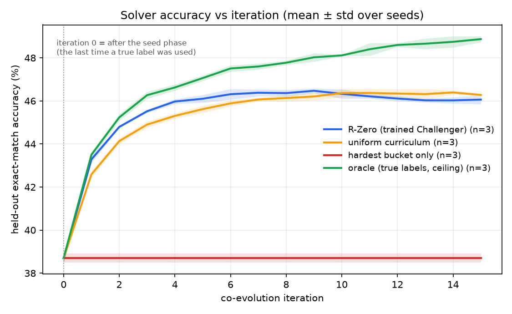
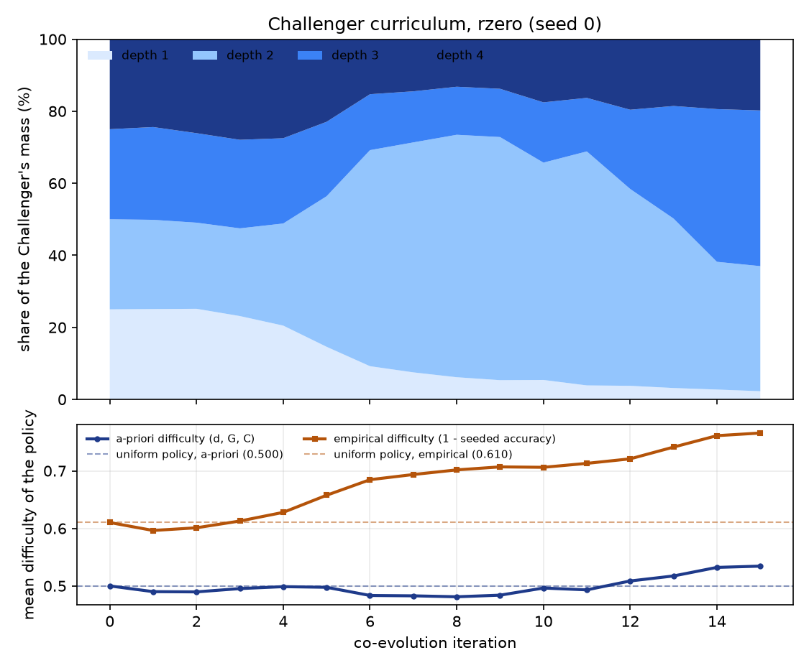
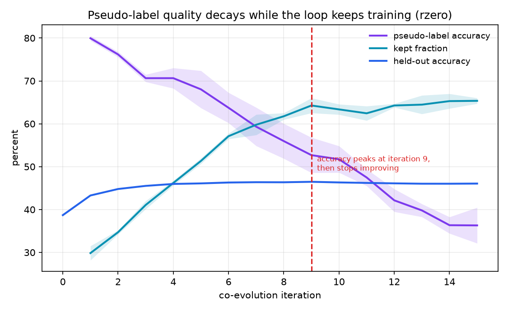

# mini-R-Zero on MiniGrid-Exec

A minimal, self-contained, CPU-only demo of the **R-Zero** co-evolution loop
(Huang et al., [arXiv:2508.05004](https://arxiv.org/abs/2508.05004)) on a toy
domain, written in numpy with matplotlib for the figures.

The point is **not** to reproduce R-Zero's numbers. It is to build the smallest
thing that exhibits the *mechanism* — a Challenger that invents tasks at the edge
of a Solver's competence, and a Solver that improves on the majority-vote
pseudo-labels of those tasks, with **no ground-truth labels anywhere except the
one-off seed phase and evaluation** — and then to characterise honestly where it
works and where it breaks.

```
python -m venv .venv
.venv/Scripts/pip install -r requirements.txt
python demo.py          # M0 gate + 4 curricula x 3 seeds + all three figures
```

---

## 1. The domain: `MiniGrid-Exec`

A task is `(program, input grid) -> output grid`.

* **DSL (6 ops):** `rot90`, `flip_h`, `shift_rows`, `increment_colors`,
  `swap_quadrants`, `swap_colors01`.
* **A program** is an ordered sequence of `d` ops. Executing it on a `G x G` grid
  of colours `0..C-1` gives the answer.
* **Difficulty vector** `z = (d, G, C)` with `d` in `1..4`, `G` in `{3,4,5}`,
  `C` in `{2,3,4}` — **36 buckets**. Programs are enumerated exhaustively inside
  a bucket (13,986 `(bucket, program)` pairs in total), so the task family is
  finite and fully inspectable.
* **Metric:** whole-grid exact match. This is deliberately brutal — at `G=5, C=4`
  a random answer is right with probability `4^-25` — so "better than chance" is
  a meaningless bar, and every comparison here is against the Solver's *own*
  greedy output instead.
* **Format check:** a program that is semantically the identity (e.g.
  `flip_h, flip_h`) is rejected and earns the Challenger zero reward. This is the
  toy's analogue of R-Zero's malformed-question check, and it is where reward
  hacking would surface, so the loop logs how often it fires.

## 2. The method

Each iteration reproduces the paper's three phases:

1. **Challenger.** A hierarchical categorical policy (logits over the 36 buckets,
   plus logits over the programs inside each bucket) proposes a group of tasks.
   The **frozen** Solver answers each one `m = 10` times; `p_hat` is the
   majority-vote agreement rate. GRPO-lite updates the policy on
   `r = max(0, r_uncertainty - r_rep)`, zeroed where the format check fails,
   with `r_uncertainty = 1 - 2|p_hat - 1/2|` (peaks at `p_hat = 0.5`, the
   frontier) and `r_rep = lam * |C_k| / B` clustering by `(bucket, first op)`.
2. **Dataset.** Sample `N = 1500` candidates from the now-frozen Challenger,
   pseudo-label each by majority vote, and keep only those with
   `|p_hat - 1/2| <= delta = 0.25`.
3. **Solver.** Train the live Solver on its own consensus labels for the kept
   tasks.

The Challenger never sees a ground-truth label — it only observes how much the
Solver agrees with *itself*.

### The zero-label guarantee

Acceptance criterion §6.7 is the load-bearing constraint: if labels leak, the
experiment proves nothing. Every ground-truth read funnels through
`domain.assert_ground_truth_allowed(purpose)`, which **raises** unless the
purpose is one of:

| purpose | where | why it is legitimate |
|---|---|---|
| `seed` | `seed.py` only | the one-off pretraining phase, standing in for "start from a pretrained base model" |
| `eval` | the held-out test set, and `pseudo_label_accuracy` | measurement only — never read by the Challenger, the filter, or `train_step` |
| `oracle` | `--mode oracle` only | the deliberately-cheating ceiling baseline from M1; no zero-label claim is ever made from it |

Every such call site is marked `# GROUND TRUTH` in the source, and
`test_experiment.py::test_loop_reads_no_labels` runs a real (tiny) iteration with
the guard and `make_tasks` instrumented, asserting at runtime that no other
purpose is ever requested. A future edit that quietly labelled a training batch
fails that test even if it never trips the guard.

## 3. Two deviations from the issue's stated spec

Both were forced by measured failures, both are recorded in full in
[`WORK_LOG-4.md`](../../WORK_LOG-4.md), and both are why M0 passes at all.

### 3.1 Step-wise Solver instead of a flat MLP

The issue specifies a flat MLP over one-hot `[program tokens || input grid]`.
Built exactly that way, **M0 failed**: seeded on depth-1 tasks, depth-2 accuracy
was 0–4% in *every* bucket. A flat MLP has never seen program slot 2 occupied, so
its weights there are still at initialisation. Depth was a **cliff, not a slope**,
and a cliff has no frontier to sit on.

The fix applies one **shared, op-conditioned block per program step**, feeding its
own soft prediction forward:

```
state_0 = input grid
state_t = softmax(block(state_{t-1}, op_t))
answer  = argmax(state_d)
```

Weight sharing lets depth-1 competence transfer to depth 4 — but *imperfectly*,
because each step consumes the previous step's **predicted** grid, so errors
compound with depth. That is exactly the graded slope the method needs, and it is
a closer analogue of a reasoning chain than the flat MLP was: an early mistake
corrupts everything downstream.

Steps past a program's depth are right-padded and carry the state through
untouched via an explicit activity mask. (Left-padding was tried first and
deadlocked training completely — loss pinned at `ln 2 = 0.6931` for 2000 steps,
because there was no gradient path to "pad = identity".)

### 3.2 Committee of 10 Solvers instead of MC-dropout

The issue suggests MC-dropout for the `m` samples. In a chained model, dropout
noise **compounds across steps**: at rate 0.15 all 10 samples land somewhere
different, `p_hat` pins to 0.10, and the vote scored 0–19% where greedy scored
72–94%. Lowering the rate only trades one degeneracy for the other (all samples
identical, `p_hat = 1`, no signal at all).

Replaced with a **committee of 10 independently initialised Solvers**, each
contributing its own greedy answer — the strongest available reading of the
issue's own phrase "`m` genuinely different functions". MC-dropout is retained as
an optional top-up but defaults to off.

## 4. M0: does a reachable frontier exist?

M0 is a gate, not a formality — the issue records a prior prototype dying exactly
here, and this one did too on its first build. It is run *before* any R-Zero
machinery, because building a Challenger without knowing the frontier exists is
building on sand.

Seed = all nine depth-1 buckets, 1200 steps, committee of 10 (1.27M params
total). The issue specifies seeding on the single easiest bucket `(1,3,2)`; that
left the Solver at 0% on every bucket with a different `G` or `C`, because those
input features were never activated. Seeding across all depth-1 buckets is the
issue's own "strengthen the seed phase" remedy — broad but shallow competence,
the honest analogue of a pretrained base model, with every depth > 1 still
entirely unlabelled.

| gate | result |
|---|---|
| seed bucket >= 90% | **PASS** — `(1,3,2)` at 99.0% |
| frontier >= 25% on a harder bucket | **PASS** — 14 unseeded buckets in the 5–95% band |
| hardest bucket near 0% | **PASS** — `(4,5,4)` at 0.0% |
| vote beats a single sample | **PASS** |
| **vote beats greedy** *(added)* | **PASS** |

Frontier pseudo-label quality — the numbers that actually matter:

| bucket | vote | single sample | greedy | mean `p_hat` |
|---|---|---|---|---|
| (2,3,4) | **58.3%** | 26.7% | 6.2% | 0.33 |
| (2,4,3) | **56.2%** | 24.8% | 25.0% | 0.30 |
| (3,3,3) | **75.0%** | 52.3% | 35.4% | 0.57 |
| (4,3,3) | **83.3%** | 52.9% | 33.3% | 0.55 |

**Why a fifth gate was added.** The issue only asks that the vote beat a *single
sample*. That check passed even in the completely broken MC-dropout configuration
where the vote was four times *worse* than greedy — and training on pseudo-labels
no better than the Solver's own greedy output is self-distillation, which lets no
information into the loop. Beating greedy is the condition that actually
determines whether the loop can learn anything, so it is the one gated on.

## 5. Results

All numbers are 3 seeds x 15 iterations. Iteration 0 is the post-seed snapshot —
**the last moment a true label was used**. Every mode starts from byte-identical
seeded weights (the seed phase is cached and mode-independent), so the per-seed
deltas below are properly paired.



| run | iter 0 | best (iter) | final | seed-to-seed std at best |
|---|---|---|---|---|
| `rzero` | 38.7% | **46.5%** (9) | 46.1% | 0.1 pp |
| `uniform` | 38.7% | **46.4%** (14) | 46.3% | 0.1 pp |
| `hardest` | 38.7% | **38.7%** (0) | 38.7% | 0.2 pp |
| `oracle` (ceiling, true labels) | 38.7% | **48.9%** (15) | 48.9% | 0.1 pp |
| `rzero --no-rep-penalty` | 38.7% | **46.3%** (7) | 45.5% | 0.1 pp |
| `rzero --no-filter` | 38.7% | **46.1%** (7) | 45.3% | 0.1 pp |
| `rzero --single-model` | 38.7% | **46.5%** (10) | 46.2% | 0.3 pp |

**The headline: the loop works.** Held-out exact-match accuracy rises
**38.7% → 46.5%, a +7.8pp gain with no ground-truth labels at all** after the
seed phase, consistent across all three seeds (std 0.1pp). The `oracle` ceiling —
identical curriculum, but trained on true labels — reaches 48.9%, so
**pseudo-label noise costs only 2.4pp** of a 10.2pp achievable gain. Majority
voting is recovering most of the available signal.

Paired per-seed deltas at each run's best iteration:

```
rzero - uniform  =  +0.1 pp   (per seed: +0.1 +0.1 +0.1)
rzero - hardest  =  +7.8 pp   (per seed: +7.4 +8.0 +7.9)
rzero - oracle   =  -2.4 pp   (per seed: -2.7 -2.2 -2.3)
```

### 5.1 The curriculum escalates — but not on the axis the issue specifies



The a-priori difficulty score in `domain.py` averages the three normalised axes
`(d, G, C)` with equal weight. **In this domain that is simply not how hard a
bucket is:** the seeded Solver scores 0.8% on `(1,5,4)` but 95.2% on
`(4,3,2)`, so the a-priori axis orders those two backwards. Measured on it, the
Challenger looks static — 0.496 → 0.525 against a uniform-policy reference of
0.500.

So escalation is reported on **both** axes. The second is empirical difficulty,
`1 − (seeded Solver's per-bucket accuracy)`, fixed once at iteration 0 and never
updated — a constant vector, so "the Challenger moved to harder tasks" stays a
claim about the Challenger and not a moving target.

| axis | iter 1 → 15 | uniform-policy reference |
|---|---|---|
| a-priori `(d, G, C)` | 0.496 → 0.525 | 0.500 |
| **empirical** (`1 − seeded accuracy`) | **0.609 → 0.781**, strictly monotone | 0.610 |

On the empirical axis the Challenger climbs monotonically across all 15
iterations and ends far above the uniform reference. Its policy also concentrates
sharply — entropy **1.47 nats against 3.58 for uniform**, with 40% of its mass on
`(3,3,4)` and 33% on `(2,3,4)`. Those are mid-depth, small-grid, many-colour
buckets: exactly the frontier, not the hardest corner of the space.

**This is the mechanism working as advertised.** The uncertainty reward found the
Solver's real competence boundary without ever being told where it was — the
a-priori axis was just a bad ruler.

### 5.2 Pseudo-label quality decays hard



| iteration | 1 | 4 | 7 | 10 | 15 |
|---|---|---|---|---|---|
| pseudo-label accuracy | 80.0% | 71.0% | 59.0% | 52.0% | **36.3%** |
| kept fraction | 30% | 46% | 60% | 63% | 65% |

Pseudo-label accuracy falls by more than half, from 80% to 36%, while the loop
keeps training on it — and the fraction of candidates passing the difficulty
filter more than doubles. Both directions match the paper's qualitative finding,
and the mechanism is visible: as the Solver improves, more of the task space
lands inside the `|p̂ − ½| ≤ 0.25` band, including tasks the committee agrees on
for the wrong reason.

## 6. Ablations (M3)

| variant | best | Δ vs full | pseudo-label acc (iter 1 → 15) | kept fraction (final) | Challenger entropy (final) |
|---|---|---|---|---|---|
| full method | 46.5% | — | 80.0% → 36.3% | 65.4% | 1.47 nats |
| `--no-rep-penalty` | 46.3% | −0.1 pp | 78.5% → 41.1% | 64.4% | **0.10 nats** |
| `--no-filter` | 46.1% | −0.3 pp | **53.5%** → 36.9% | 99.1% | — |
| `--single-model` | 46.5% | +0.0 pp | 80.0% → 42.5% | 65.3% | — |

**`--no-rep-penalty` causes total diversity collapse, which accuracy does not
show.** Without it the Challenger puts **98.7% of its mass on a single bucket**
(entropy 0.10 nats vs 1.47 for the full method). The repetition penalty is doing
precisely its stated job. Yet best accuracy moves by only −0.1pp — because with
13,986 enumerable `(bucket, program)` pairs, one bucket still contains hundreds
of distinct programs, so a collapsed *bucket* distribution is not a collapsed
*task* distribution. The sustained cost is visible instead in the final number
(45.5% vs 46.1%): the collapsed run decays faster after its peak.

**`--no-filter` degrades pseudo-labels immediately, as designed.** Kept fraction
jumps to 99% and pseudo-label accuracy at iteration 1 drops from 80.0% to
**53.5%** — the filter is removing exactly the junk it is supposed to. Peak
accuracy still only falls 0.3pp, because the mislabelled tasks are largely ones
the Solver is already wrong about, so training on them is closer to a no-op than
to active poisoning.

**`--single-model` is a no-op in this implementation, and that is a fact about
the code, not a result about the method.** Within an iteration, phase 1 and 2
both complete before phase 3 trains the Solver, so `sol.clone()` and the live
`sol` hold *identical weights* for the entire time the Challenger is probing.
Ablating the freeze therefore changes nothing; the ±0.1pp spread comes only from
`clone()` drawing member RNG seeds and shifting the random stream. R-Zero's
freeze matters because there the Challenger is separately RL-trained against a
Solver checkpoint — this toy's phase ordering gets the freeze for free. Reported
here rather than quietly dropped, because a 0.0pp ablation delta invites exactly
the wrong conclusion.

### The `hardest` baseline never trains at all

Its curve is flat at 38.7% to four significant figures, and the reason is not
that it trains and fails. Every task in bucket `(4,5,4)` gets `p̂ = 0.100`
*exactly* — all 10 committee members disagree with each other on every single
task — so `|p̂ − ½| = 0.4` fails the `δ = 0.25` filter and **zero tasks are kept
in every one of the 15 iterations**. The Solver is never updated.

This is a cleaner result than a degraded curve would have been: the difficulty
filter correctly refuses to manufacture labels for tasks past the frontier, so a
curriculum aimed entirely beyond the Solver's reach degenerates to a no-op rather
than to poisoning.

## 7. Which of the paper's findings reproduced?

The issue asks for an honest accounting of four findings. One reproduced
clearly, two reproduced partially, and one did not reproduce.

| # | paper finding | verdict | evidence |
|---|---|---|---|
| 1 | trained Challenger beats untrained | **Not reproduced (partial at best)** | `rzero` 46.5% vs `uniform` 46.4% — +0.1pp, indistinguishable at the plateau |
| 2 | ablating components hurts | **Partially reproduced** | effects are real but small in accuracy (−0.1 to −0.3pp); the *mechanisms* ablate exactly as predicted |
| 3 | pseudo-label accuracy decays | **Reproduced clearly** | 80.0% → 36.3% over 15 iterations |
| 4 | performance eventually collapses | **Partially reproduced** | peak at iteration 9, then a drift down to 46.1% — a plateau-and-sag, not a collapse |

**Finding 1 — the honest version.** At the plateau, a trained Challenger and a
uniform random curriculum are the same to within 0.1pp. There is a real *early*
advantage — `rzero` leads `uniform` by 0.7pp at iteration 1 and 0.7pp at
iteration 4 — so the trained Challenger gets to the same place faster, but it
does not get anywhere better. The most likely reason is the domain: 36 buckets
over 13,986 enumerable tasks is small enough that uniform sampling hits the
frontier often by accident, and the difficulty filter then discards everything
uniform sampled wrongly. In other words **the filter, not the Challenger, is
doing the curriculum work here.** A domain where the frontier is a vanishing
fraction of the task space is where the trained Challenger should start to pay,
and this toy is not that domain.

**Finding 2 — the accuracy metric hides what the ablations actually do.** Judged
on best accuracy alone, every ablation is within 0.3pp and the honest summary
would be "no effect". Judged on mechanism, each ablation does exactly what the
paper predicts: the repetition penalty is the only thing preventing a 98.7%
single-bucket collapse, and the difficulty filter is worth 26pp of pseudo-label
accuracy at iteration 1. The components work; this domain is just too forgiving
for that to show up in the headline number.

**Finding 4 — no true collapse, and the reason is structural.** Accuracy peaks at
iteration 9 and sags to 46.1% by iteration 15 while pseudo-label accuracy is in
free-fall to 36.3%. That the Solver only loses 0.4pp while its training labels
lose 44pp of accuracy is the interesting part: it suggests the wrong labels are
concentrated on tasks the Solver cannot do anyway, so they act as noise rather
than as active corruption. This may be a genuine limit of a **finite, enumerable
task space** — the toy runs out of frontier before it runs out of pseudo-label
quality. Longer runs are the obvious follow-up, but the 15-iteration budget was
what the CPU-time constraint allowed.

### Wall clock (laptop CPU, 3 seeds each)

| run | time |
|---|---|
| `rzero` | 3.9 min |
| `uniform` | 1.9 min |
| `hardest` | 0.9 min |
| `oracle` | 3.7 min |
| `--no-rep-penalty` | 3.7 min |
| `--no-filter` | 5.4 min |
| `--single-model` | 3.7 min |

`demo.py` (M0 gate + the four curricula + all three figures) runs in about
**11 minutes**, inside the issue's 30-minute budget. The full matrix including
ablations takes about 23 minutes.

## 8. Files

| file | what it is |
|---|---|
| `domain.py` | the DSL, buckets, program enumeration, execution, encoding, format check, held-out test set, and the ground-truth guard |
| `solver.py` | the step-wise numpy Solver, hand-written Adam and BPTT, the committee, MC-dropout sampling, and majority voting |
| `seed.py` | the seed phase (the only labelled training) and the M0 sanity gate |
| `challenger.py` | the hierarchical policy, the three reward terms, and GRPO-lite |
| `loop.py` | the three-phase co-evolution loop and per-iteration JSON logging |
| `run.py` | CLI: `--mode`, `--ablate`, `--seeds`, `--iters`, `--m0`, ... |
| `demo.py` | one command: M0 gate, four curricula at three seeds, all three figures |
| `plots.py` | regenerates all three figures from `results/*.json` without retraining |
| `test_experiment.py` | the test suite, including a finite-difference check of the hand-written BPTT and a runtime no-label-leak check |

## 9. Reproducing

```
python demo.py                                        # the headline result
python run.py --m0                                    # just the M0 gate
python run.py --mode rzero   --seeds 3 --iters 15     # one curriculum
python run.py --mode rzero --ablate no-filter --seeds 3 --iters 15
python plots.py                                       # figures, from JSON only
python test_experiment.py                             # the test suite
```

The seed phase is cached to `results/seed_cache/` keyed by
`(seed, steps, committee)`. It does not depend on the mode, so every mode starts
from **byte-identical** weights and mode comparisons are properly paired — which
is also why the per-seed deltas above are meaningful at n=3.
