# Final report: evolve-harness v4 on ft09 and vc33

Both games finished all 5 rounds in **one part each**, running in parallel on TC1 (script A: one job per game, 10 CPUs / 30 GB each, 20 CPUs / 60 GB in all, no GPU). Both roles used `Qwen/Qwen3.8-27B-FP8`, because the flash model still returned HTTP 500 (same as #15).

| | ft09 | vc33 |
|---|---|---|
| job | 75435, COMPLETED 0:0, 3 h 03 min | 75436, COMPLETED 0:0, 3 h 28 min |
| `seff` | 1 min 40 s CPU, 155 MB | 2 min 03 s CPU, 156 MB |
| v0 → final parent | 0.30 → **0.80** (v4) | 0.00 → **1.00** (v4) |
| clears of the final parent | 1/5 | **5/5**, in 3–5 actions |
| accepted versions | v1, v4 | v1, v2, v3, v4 |
| dropped at Validate | repeat 8, state-change 1, fact-check 1 | skill-name 2, skill test 2, fact-check 1, applies 1 |

**In short:**
- vc33 is solved on Level 1: v4 clears every seed in 3–5 clicks.
- ft09 went from 0.30 to 0.80, but it still clears only 1 seed in 5. Its main mistake is treating the bar on row 63 as the goal. The action record shows that bar changes after every action.
- The repeat check did most of the visible work. It dropped 8 of ft09's 19 proposed edits (42%, the same rate #15 would have had).
- The state-change check dropped one skill, `solve_level`. That looks like a **false drop**: all 5 states it tested were turn 0, where that skill has nothing to click. Details and a fix are under ft09 below.

Figures and tables come from `python -m analysis.issue16_report`, which writes `results/issue16/final.json` and `results/issue16/figures/` from the saved runs. The replays come from `python -m analysis.issue16_replays`.

## How the two games were finished

Each replay shows the final version (v4) of each game, rebuilt from the saved frames of its winning episode. It shows the frame after each action, a ring on each click, and the action-record line for that action.

**vc33 · v4 · seed 1: cleared in 3 clicks.**
- v4's hints say the maroon button at (61, 33) moves the black region left by 4 columns.
- The player clicks it once per turn and checks where the region went. On the third click the region lines up and Level 1 is cleared.
- All five seeds were won the same way: three clicks on (61, 33).

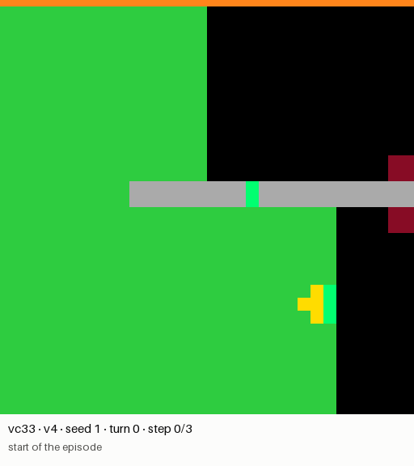

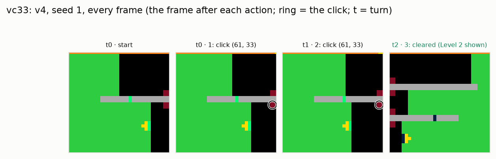

**ft09 · v4 · seed 5: cleared in 37 clicks, partly by luck.** This is the only v4 seed that cleared.
1. In turns 1–9 the player toggles the blocks of the 3×3 grid between maroon and cyan, trying to fill the bar on row 63, which it takes for the goal.
2. That bar moves on with every click. When it fills at step 33, the game is over and the harness restarts the level.
3. The rest of turn 9's code keeps running on the fresh board: three clicks planned for the old board.
4. In turn 10 the player calls `auto_solve`, whose first click clears Level 1.

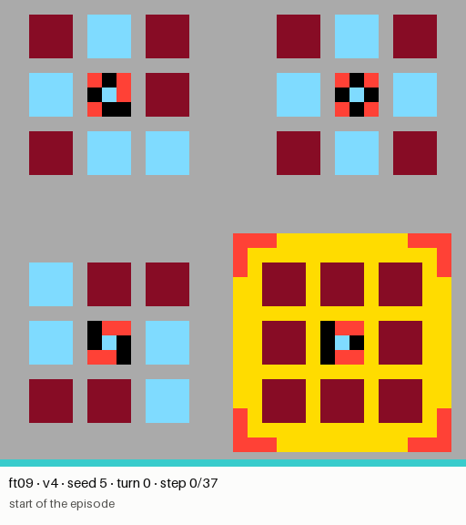

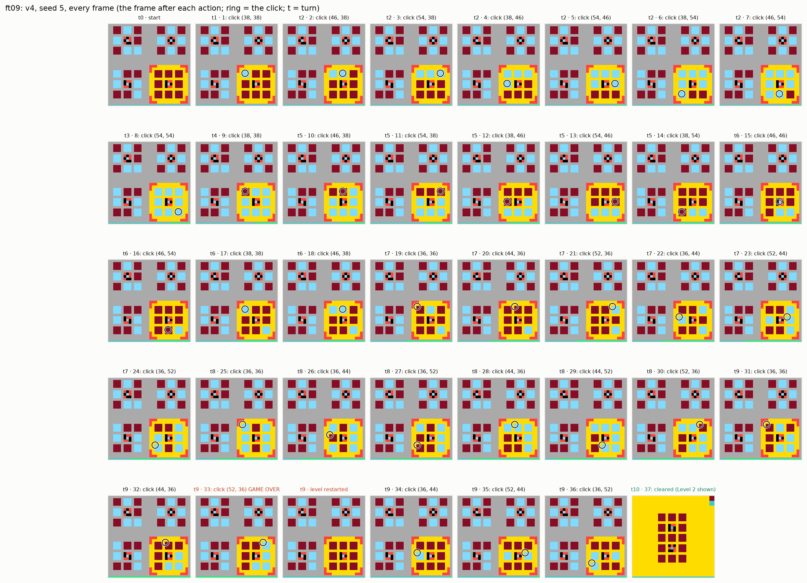

---

## ft09

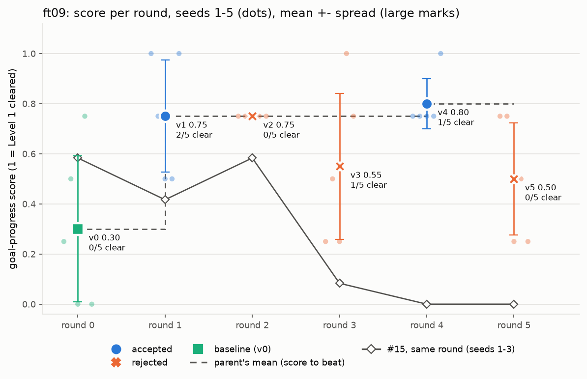

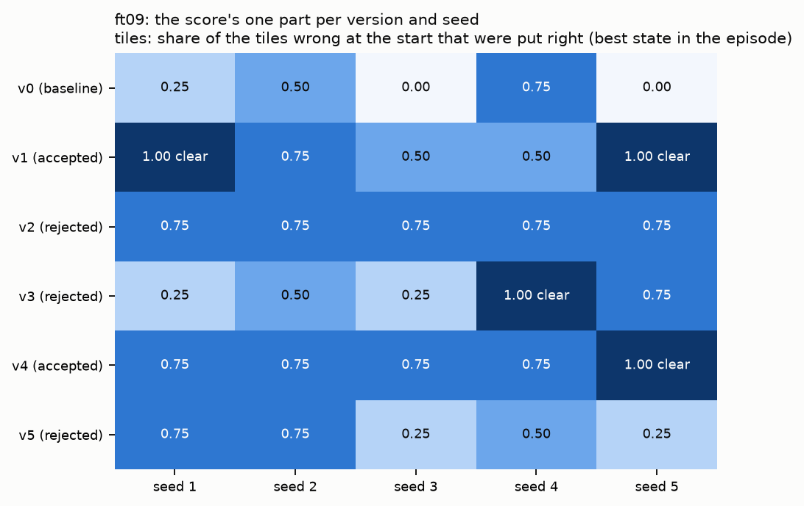

The score has one part, `tiles`: the share of the tiles that were wrong at the start and were put right, at the best state in the episode. The second figure is therefore also the score split, shown per seed.

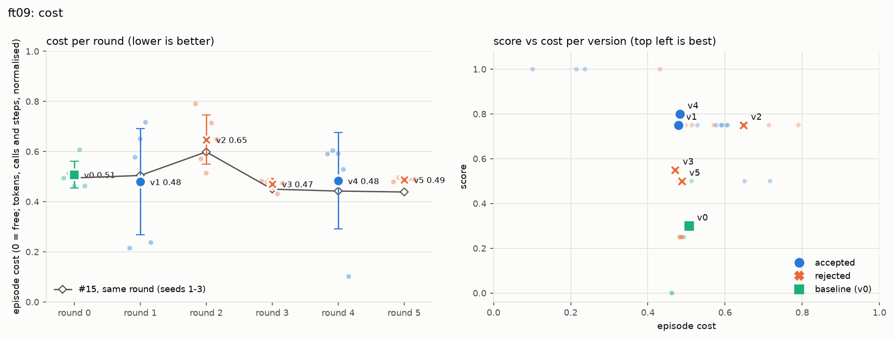

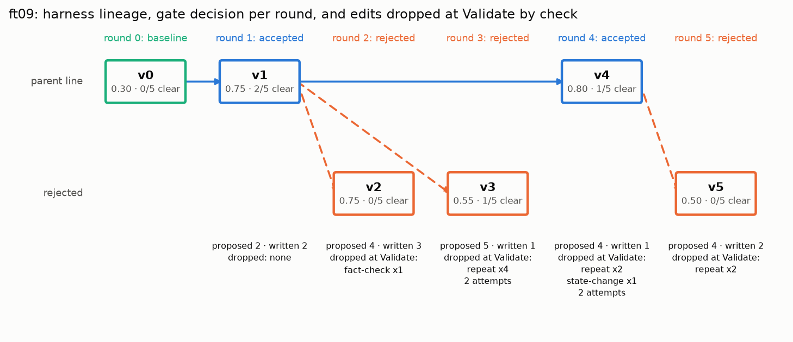

**Per round**

| round | version | parent | mean (seeds 1–5) | mean (seeds 1–3) | clears | avg steps | avg cost | gate | reason |
|---|---|---|---|---|---|---|---|---|---|
| 0 | v0 | – | 0.30 ± 0.29 | 0.25 | 0/5 | 200.0 | 0.508 | baseline | starting parent |
| 1 | v1 | v0 | 0.75 ± 0.22 | 0.75 | 2/5 | 148.4 | 0.479 | **accepted** | gate-score gain +0.464 |
| 2 | v2 | v1 | 0.75 ± 0.00 | 0.75 | 0/5 | 200.0 | 0.647 | rejected | tie on progress; child not cheaper (cost +0.168) |
| 3 | v3 | v1 | 0.55 ± 0.29 | 0.33 | 1/5 | 196.4 | 0.471 | rejected | no gate-score gain (−0.196; progress −0.20) |
| 4 | v4 | v1 | 0.80 ± 0.10 | 0.75 | 1/5 | 167.4 | 0.483 | **accepted** | gate-score gain +0.048 |
| 5 | v5 | v4 | 0.50 ± 0.22 | 0.58 | 0/5 | 200.0 | 0.488 | rejected | no gate-score gain (−0.302; progress −0.30) |

**Per seed** (✓ = cleared)

| version | seed 1 | seed 2 | seed 3 | seed 4 | seed 5 |
|---|---|---|---|---|---|
| v0 | 0.25 | 0.50 | 0.00 | 0.75 | 0.00 |
| v1 | 1.00 ✓ | 0.75 | 0.50 | 0.50 | 1.00 ✓ |
| v2 | 0.75 | 0.75 | 0.75 | 0.75 | 0.75 |
| v3 | 0.25 | 0.50 | 0.25 | 1.00 ✓ | 0.75 |
| v4 | 0.75 | 0.75 | 0.75 | 0.75 | 1.00 ✓ |
| v5 | 0.75 | 0.75 | 0.25 | 0.50 | 0.25 |

**Edits per round** (all attempts)

| round | attempts | promote / merge / delete / edit | from the Meta LLM | dropped at Validate | written |
|---|---|---|---|---|---|
| 1 | 1 | 0 / 0 / 0 / 2 | 2 | – | 2: add skill `find_interactive_blocks`, add prompt `game_hints` |
| 2 | 1 | 0 / 0 / 2 / 2 | 2 | fact-check 1 | 3: delete `bfs_to_target`, delete `obstacle_map` (rule), add skill `click_progress` |
| 3 | 2 | 0 / 0 / 2 / 3 | 3 | **repeat 4** | 1: edit prompt `game_hints` |
| 4 | 2 | 0 / 0 / 2 / 2 | 2 | **repeat 2, state-change 1** | 1: add skill `auto_solve` |
| 5 | 1 | 0 / 0 / 2 / 2 | 2 | **repeat 2** | 2: edit skill `auto_solve`, edit prompt `game_hints` |

The rule-based proposer suggested no promotions or merges: the player wrote no inline helper that it reused.

**State-change check:** 4 skills checked, 1 dropped, 0 unverifiable, 227 game steps.

| round | skill | verdict | from 5 states |
|---|---|---|---|
| 2 | `click_progress` (new) | changed | 1 action, 36 cells each |
| 4, attempt 1 | `solve_level` (new) | **no change → dropped** | 0 actions, 0 cells, at seeds 1–5, turn 0 |
| 4, attempt 2 | `auto_solve` (new) | changed | 6 actions, 216 cells each |
| 5 | `auto_solve` (edited) | changed | 6 actions, 144–216 cells; states at turns 4–20 (the parent called it) |

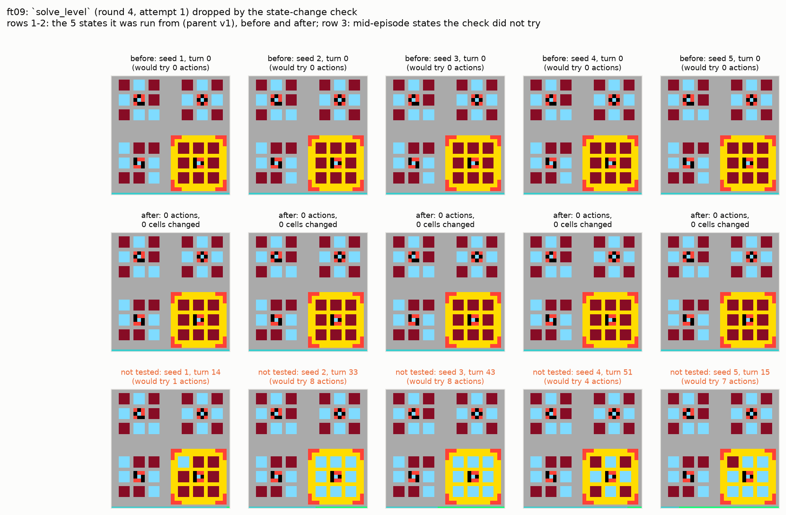

**Why I think the `solve_level` drop is false:**
- `solve_level` clicks only the cyan (8) blocks among the 8 outer blocks.
- The parent v1 never called it, so the check picked one state per seed in spread order. With 5 seeds, every pick was turn 0, and at turn 0 all 8 blocks are maroon.
- It therefore took 0 actions from every state. Mid-episode it would try 1–8 clicks (row 3 of the figure; I counted these by running the skill with `action()` stubbed out).
- The check measured correctly, but the states it chose could not show what the skill does.
- Whether the skill would have helped is a separate question. Its guessed goal ("all maroon") is the start state, so it is not the win condition.

**Repeat check:** 8 edits dropped, all with similarity 1.00.

| dropped | proposer | repeats | which was rejected by |
|---|---|---|---|
| r3-e1, r4-e1, r5-e1: delete skill `bfs_to_target` | rule | r2-gate-e1 | Gate, v2: tie on progress, child not cheaper |
| r3-e2, r4-e2, r5-e2: delete skill `obstacle_map` | rule | r2-gate-e2 | Gate, v2 |
| r3-e3: add skill `click_progress` | Meta | r2-gate-e3 | Gate, v2 |
| r3-e4: edit prompt `game_hints` | Meta | r2-a1-e4 | Validate, round 2: fact-check ("the goal is to fill the progress bar on row 63") |

- 6 of the 8 drops are the same two rule-based deletes of skills that were never called.
- They count as rejected only because they were bundled into v2, which lost at the Gate because of its cost.
- The repeat check keeps those deletes blocked for the rest of the run, even after the parent changed to v4.
- The rejected-edit store has 16 entries.

**Rejected since current parent:**

| round | parent | versions shown | dropped edits shown | section size | Meta edits proposed | of those, repeats |
|---|---|---|---|---|---|---|
| 1 | v0 | – | 0 | "None so far" | 2 | 0 |
| 2 | v1 | – | 0 | "None so far" | 2 | 0 |
| 3 | v1 | v2 | 1 | 5.7k chars | 2 + 1 (retry) | **2** (first call) |
| 4 | v1 | v2, v3 | 5 | 8.7k chars | 1 + 1 (retry) | 0 |
| 5 | v4 | – | 0 | "None so far" | 2 | 0 |

- In round 3, the first Meta call proposed both edits the section listed as rejected, word for word. The repeat check dropped them, and the retry proposed a different `game_hints` edit.
- In round 4, both calls proposed new skills, and the second one (`auto_solve`) became v4, the accepted version.

**Frame evidence and clicks**

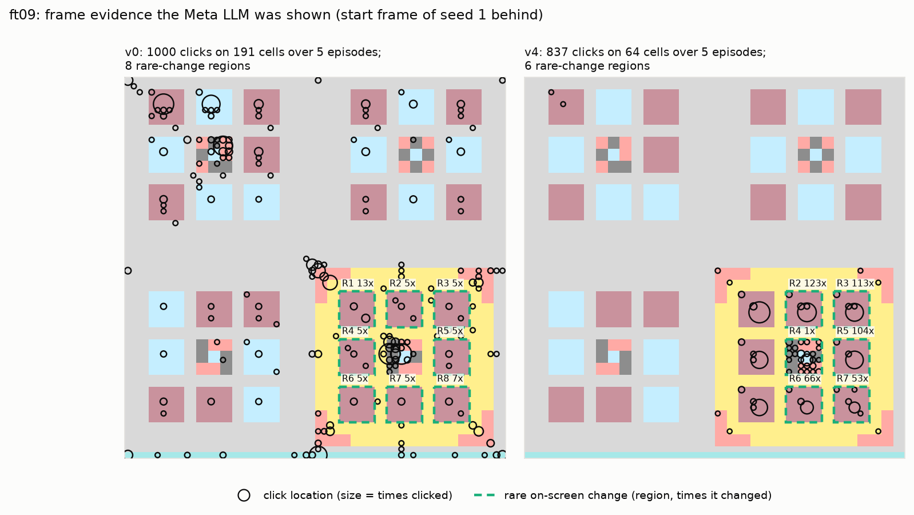

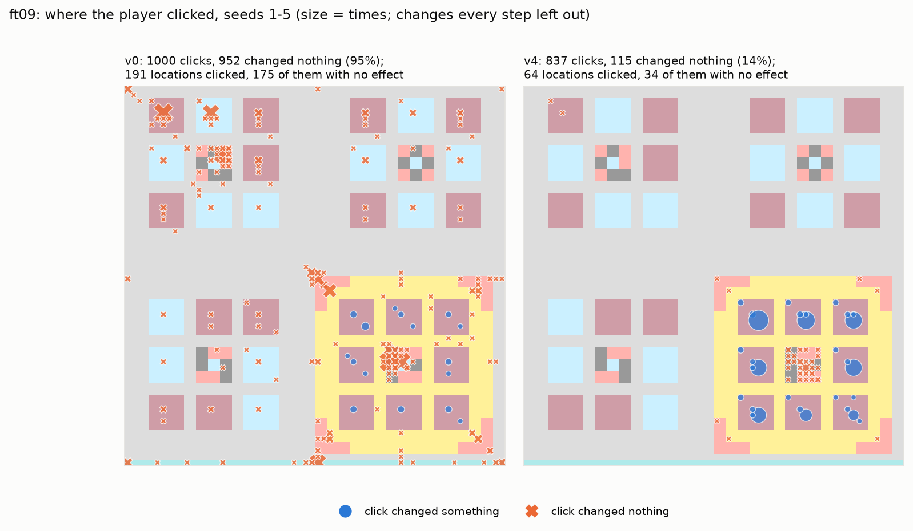

- v0 clicked all over the screen: 95% of its clicks changed nothing.
- v4 clicks only the 3×3 block grid: 14% changed nothing, and 105 of those 115 are on the centre block, which does not respond.

**Action record in the player's context:** v4, seed 5, turn 8. This is the block that turn's message carried, rebuilt from the saved frames. Its length, 2,282 chars, matches the `action_record_chars` that turn logged.

```
ACTION RECORD (what each action changed on screen, measured by comparing the frame before and after it; clicks as (x, y), the order action() takes them, "on N" = the cell's value before the click)
Changes every step (left out below): row 63, cols 18–63
Last 20 of 24 actions:
step 5 · click (54, 46) on 9 · 36 cells changed · rows 44–49, cols 52–57 · 9→8
step 6 · click (38, 54) on 9 · 36 cells changed · rows 52–57, cols 36–41 · 9→8
...
step 14 · click (38, 54) on 8 · 36 cells changed · rows 52–57, cols 36–41 · 8→9
step 15 · click (46, 46) on 8 · no change
step 16 · click (46, 54) on 8 · 36 cells changed · rows 52–57, cols 44–49 · 8→9
...
step 24 · click (36, 52) on 9 · 36 cells changed · rows 52–57, cols 36–41 · 9→8
Clicks this episode: 24 on 15 locations, 23 changed something. By location: (38, 38) ×3 (3 changed), (46, 38) ×3 (3 changed), ... (46, 46) ×1 (0 changed), ...
```

The full text is in `final.json` → `ft09.action_record_example`.

**Replay of the final parent**

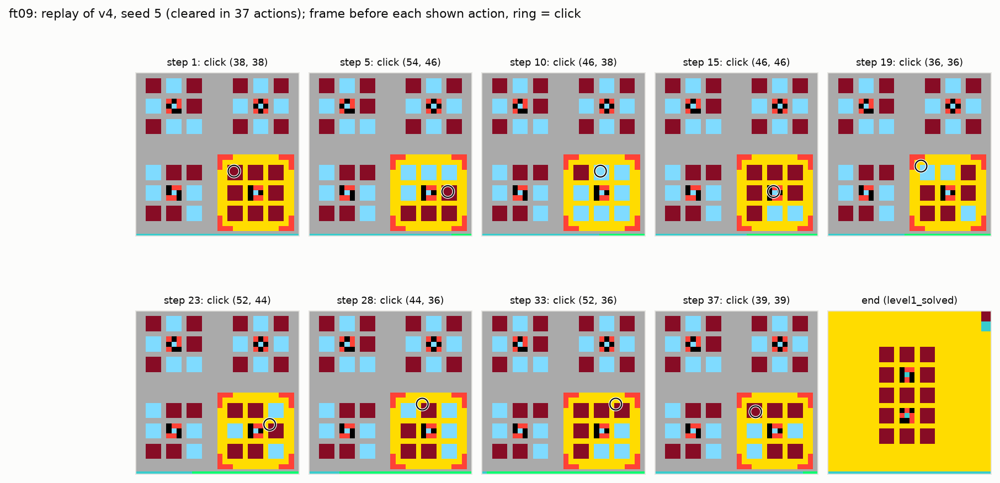

This is v4, **seed 5**, the one v4 seed that cleared, in 37 actions.

**Helpers and `action_log`:**
- The player wrote no reusable inline helper, so nothing was promoted.
- No skill uses `action_log`. The player's own code used it in 4 turns, across 2 episodes.

**Main failure modes:**
1. **Wrong goal.**
   - The Meta LLM keeps treating the row-63 bar as the goal ("fill the progress bar"). That bar changes after every action, and the action record lists it as every-step.
   - The fact-check dropped that claim once (round 2), but v4's hints still say "Goal: likely to toggle all blocks to a specific color or fill the progress bar".
2. **Game over and level resets.** v2–v5 average 4–6 level resets per episode, and 4 or 5 of the 5 episodes per version used up the 200-action budget.
3. **Blind cycling.** `auto_solve` cycles through the blocks without a target pattern. In round 5 the Meta LLM said this itself; its fix (v5) made things worse (0.50).

---

## vc33

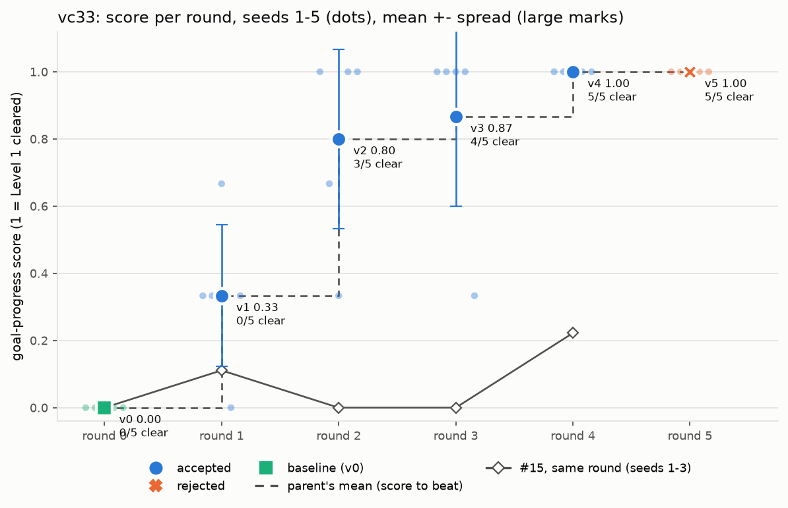

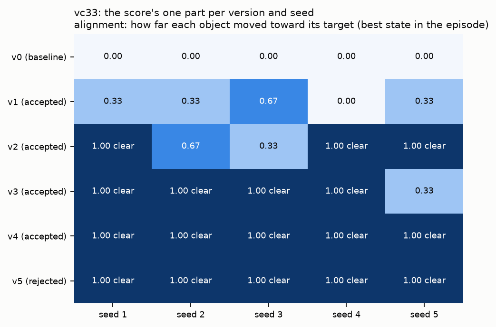

The score has one part, `alignment`: how far each object moved toward its target, at the best state.

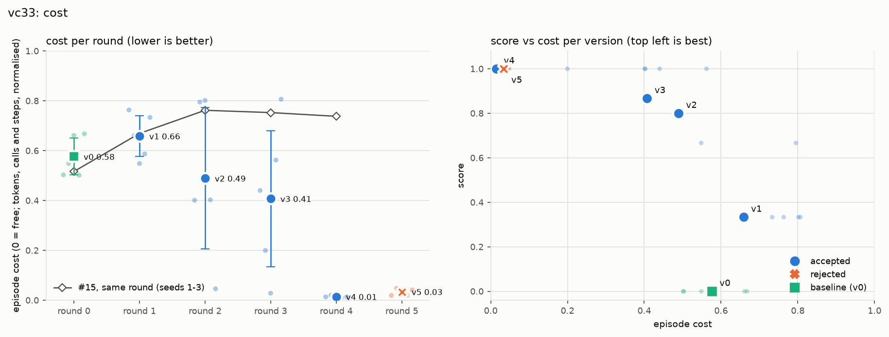

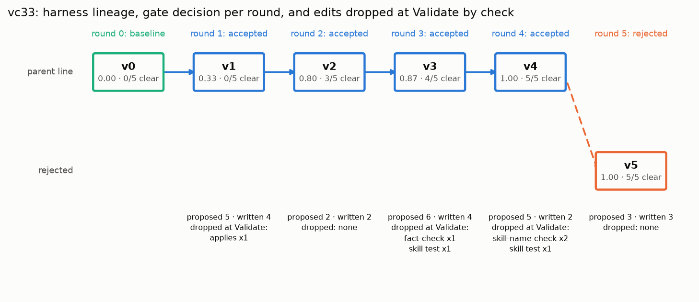

**Per round**

| round | version | parent | mean (seeds 1–5) | mean (seeds 1–3) | clears | avg steps | avg cost | gate | reason |
|---|---|---|---|---|---|---|---|---|---|
| 0 | v0 | – | 0.00 ± 0.00 | 0.00 | 0/5 | 200.0 | 0.577 | baseline | starting parent |
| 1 | v1 | v0 | 0.33 ± 0.21 | 0.44 | 0/5 | 200.0 | 0.659 | **accepted** | gate-score gain +0.292 |
| 2 | v2 | v1 | 0.80 ± 0.27 | 0.67 | 3/5 | 73.4 | 0.489 | **accepted** | gate-score gain +0.551 |
| 3 | v3 | v2 | 0.87 ± 0.27 | 1.00 | 4/5 | 52.6 | 0.407 | **accepted** | gate-score gain +0.108 |
| 4 | v4 | v3 | 1.00 ± 0.00 | 1.00 | 5/5 | 3.0 | 0.014 | **accepted** | gate-score gain +0.330 |
| 5 | v5 | v4 | 1.00 ± 0.00 | 1.00 | 5/5 | 7.4 | 0.034 | rejected | tie on progress; child not cheaper (cost +0.020) |

**Per seed** (✓ = cleared)

| version | seed 1 | seed 2 | seed 3 | seed 4 | seed 5 |
|---|---|---|---|---|---|
| v0 | 0.00 | 0.00 | 0.00 | 0.00 | 0.00 |
| v1 | 0.33 | 0.33 | 0.67 | 0.00 | 0.33 |
| v2 | 1.00 ✓ | 0.67 | 0.33 | 1.00 ✓ | 1.00 ✓ |
| v3 | 1.00 ✓ | 1.00 ✓ | 1.00 ✓ | 1.00 ✓ | 0.33 |
| v4 | 1.00 ✓ | 1.00 ✓ | 1.00 ✓ | 1.00 ✓ | 1.00 ✓ |
| v5 | 1.00 ✓ | 1.00 ✓ | 1.00 ✓ | 1.00 ✓ | 1.00 ✓ |

**Edits per round**

| round | promote / merge / delete / edit | from the Meta LLM | dropped at Validate | written |
|---|---|---|---|---|
| 1 | 3 / 0 / 0 / 2 | 2 | applies 1 (`has_black_neighbor` proposed twice) | 4: promote `has_black_neighbor`, `is_inside_black`; add prompt `game_hints`, add skill `region_state` |
| 2 | 0 / 0 / 0 / 2 | 2 | – | 2: edit `game_hints`, add skill `compare_region_states` |
| 3 | 2 / 0 / 2 / 2 | 2 | fact-check 1, skill test 1 | 4: promote `count_non_green`, `count_colors`; delete `has_black_neighbor`, `is_inside_black` |
| 4 | 3 / 0 / 0 / 2 | 2 | skill-name check 2, skill test 1 | 2: promote `count_pattern`, edit `game_hints` |
| 5 | 0 / 0 / 1 / 2 | 2 | – | 3: delete `count_non_green`, add skill `black_region_cols`, edit `game_hints` |

**State-change check:** 0 skills checked. None of vc33's new or edited skills take actions; they all read the grid.

**Repeat check:** 0 drops. Every child up to round 4 was accepted, so until round 5's Gate rejection the store held only Validate drops, and nothing proposed matched them. It had 9 entries at the end.

**Rejected since current parent:** "None so far" in every round: nothing was ever rejected under the parent of the time.

**Frame evidence and clicks**

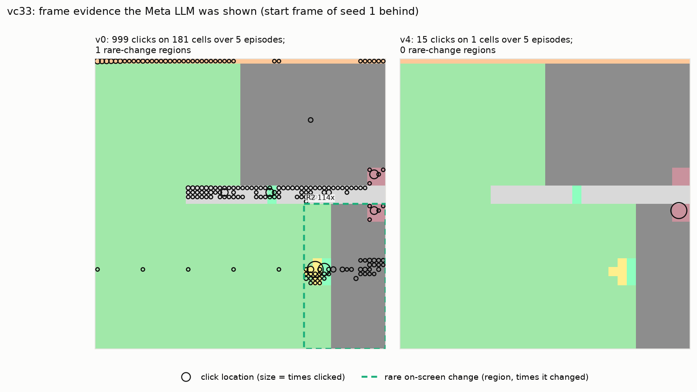

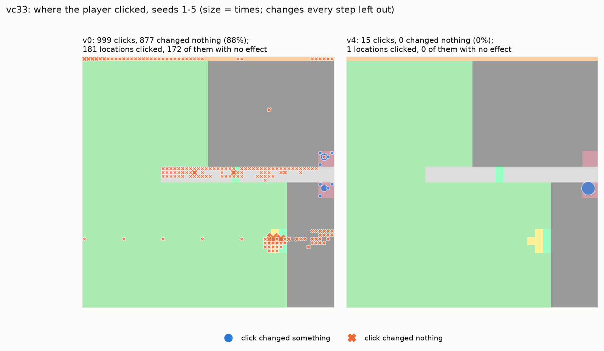

- v0 clicked row 0 (the step bar), the grey bar and the yellow shape: 88% of its clicks changed nothing.
- v4 clicks one button, (61, 33), 15 times over 5 seeds, and every click changed something.

**Action record in the player's context:** v4, seed 1, turn 2. 672 chars, matching the logged length.

```
ACTION RECORD (what each action changed on screen, ...)
Changes every step (left out below): none found
Last 2 of 2 actions:
step 1 · click (61, 33) on 9 · 265 cells changed · row 0, col 63 · 7→4; rows 1–27, cols 32–35 · 0→3; rows 32–63, cols 42–51 · 3→0 ×104, 3→4 ×16, 4→0 ×12
step 2 · click (61, 33) on 9 · 266 cells changed · row 0, cols 61–62 · 7→4; rows 1–27, cols 36–39 · 0→3; rows 32–63, cols 38–47 · 3→0 ×104, 3→4 ×16, 4→0 ×12
Clicks this episode: 2 on 1 locations, 2 changed something. By location: (61, 33) ×2 (2 changed)
```

**Replay of the final parent**

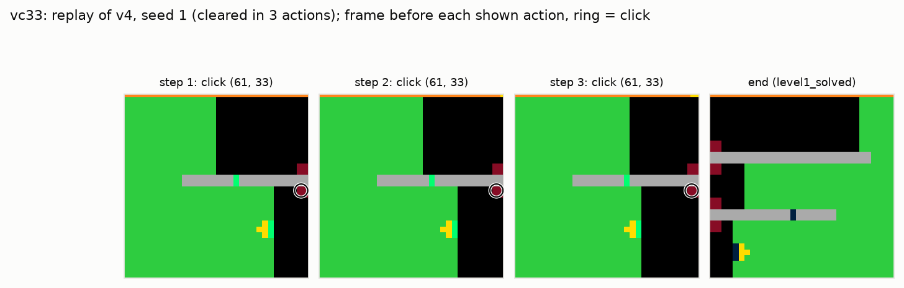

This is v4, **seed 1**: three clicks on the left button, then cleared.

**Helpers and `action_log`:**
- The player wrote inline helpers in rounds 1, 3 and 4. 8 promotions were proposed and 5 were written: `has_black_neighbor` and `is_inside_black` (v1), `count_non_green` and `count_colors` (v3), `count_pattern` (v4).
- Only `count_colors` was used after promotion (6 calls in v3). The other four were never called.
- Two `count_colors_region` promotions were dropped by #15's skill-name check, which mistook the imports `Counter` and `defaultdict` for skill names.
- No skill uses `action_log`. The player's code used it in 4 turns, across 4 episodes.

**Main failure modes:**
1. **v0–v1 click cells that do not respond** (row 0, the grey bar, the yellow shape): 83–89% of clicks changed nothing.
2. **v2–v3 call a dict as a function.** The error `TypeError: 'dict' object is not callable` (mostly from `diff(g, g2)`) appeared 38 and 56 times. Three episodes also ran out of tokens.
3. **Solved from v4 on.** The hints say which button moves the black region which way, and the player presses the left button 3–5 times.
   - One oddity: the hint "DO NOT click in row 0 … a trap that leads to GAME OVER" was dropped by the fact-check in round 3 (false: row 0 is the step counter). The same sentence passed as "unverifiable" in round 4, because the claim extraction varies between calls.

---

## Both games

**Clicks that changed nothing.** Both runs are measured with the same frame diff, with every-step regions left out.

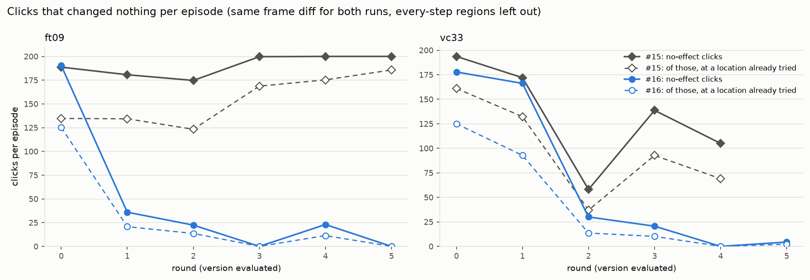

| per episode | ft09 #15 | ft09 #16 | vc33 #15 | vc33 #16 |
|---|---|---|---|---|
| v0, seeds 1–3: no-effect clicks | 188.7 | 195.3 | 193.7 | 178.0 |
| v0, seeds 1–3: of those, at a location already tried | 134.7 | 130.3 | 161.0 | 126.3 |
| later rounds: no-effect clicks | 175–200 | 0–36 | 58–139 | 0–30 (v2 on) |

**Token cost of the action record:**
- About 127k characters per episode in ft09 and 128k in vc33. That is about 32k tokens at 4 chars per token, roughly 9% and 7% of an episode's input tokens.
- The cost is highest in long episodes and near zero in vc33's 3-turn v4 episodes. (These token figures are estimates from the logged character counts.)

**Repeat rate** (proposed edits that repeat a rejected one):

| | #15 (would have been dropped) | #16 (dropped) |
|---|---|---|
| ft09 | 5 / 12 (42%) | 8 / 19 (42%) |
| vc33 | 1 / 9 (11%) | 0 / 21 (0%) |

## Comparison with #15

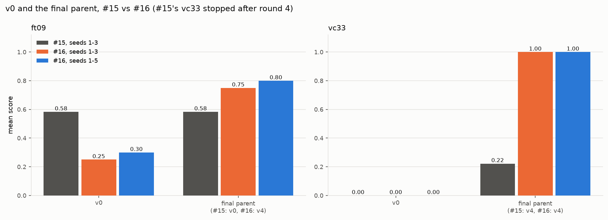

| | ft09 #15 | ft09 #16 | vc33 #15 | vc33 #16 |
|---|---|---|---|---|
| rounds done | 5 | 5 | 4 (round 5 not run) | 5 |
| seeds per round | 3 | 5 | 3 | 5 |
| v0 score, seeds 1–3 | 0.58 | 0.25 | 0.00 | 0.00 |
| v0 score, seeds 1–5 | – | 0.30 | – | 0.00 |
| final parent | v0 | v4 | v4 | v4 |
| final parent, seeds 1–3 | 0.58 | 0.75 | 0.22 | **1.00** |
| final parent, seeds 1–5 | – | 0.80 | – | **1.00** |
| improvement over v0, seeds 1–3 | 0 | +0.50 | +0.22 | +1.00 |
| clears of the final parent | 0/3 | 1/5 (0 of seeds 1–3) | 0/3 | 5/5 |
| accepted versions | none | v1, v4 | v1, v4 | v1–v4 |
| edits proposed by type | edit 10, delete 2 | edit 11, delete 8 | edit 7, delete 2 | promote 8, edit 10, delete 3 |
| dropped at Validate | none | repeat 8, state-change 1, fact-check 1 | fact-check 1 | skill-name 2, skill test 2, fact-check 1, applies 1 |
| skills promoted | 0 | 0 | 0 | 5 |
| total tokens (player + Meta + fact-check) | 4.75 M | 12.16 M | 9.65 M | 12.40 M |

**v0 here vs v0 in #15, seeds 1–3: the action record on its own.**
- The two v0s are the same harness; the only difference is the action record.
- ft09 scored 0.25 here against 0.58 in #15 (per seed: 0.25 / 0.50 / 0.00 against 0.50 / 0.75 / 0.50). vc33 scored 0 in both.
- No-effect clicks barely moved: ft09 195 against 189 per episode, vc33 178 against 194.
- So the record alone did not make v0 click better. ft09's score gap on the same seeds is the player model's sampling: one run of 3 episodes cannot separate the two.

**Which of the five changes made a visible difference:**
1. **5 seeds: yes, as a measure of noise.**
   - The same v0 on the same 3 seeds scored 0.58 in #15 and 0.25 here.
   - With 3 seeds, a gate decision can turn on one lucky episode. 5 seeds give spreads of 0.1–0.3, still large next to gate margins like v4's +0.048.
2. **State-change check: one drop, which looks false.**
   - The drop came from its choice of states (all turn 0), not from the skill.
   - The three skills that do take actions passed.
3. **Repeat check: the largest visible effect.**
   - It dropped 42% of ft09's proposals. In rounds 3 and 4 that forced a second Meta call, and round 4's second call produced v4, the best ft09 version.
   - The cost: it also kept two harmless rule-based deletes blocked for the whole run.
4. **Rejected since current parent: no clear effect.** It was non-empty only in ft09's rounds 3–4. Its first use was followed by the Meta LLM proposing the listed edits again, word for word.
5. **Action record: no clear effect on v0 alone.**
   - No-effect clicks fell sharply in later versions of both games (to 0–36 per episode, against #15's 58–200). The harness edits did that: `find_interactive_blocks`, and hints that name the buttons.
   - I can't tell from one run whether the record helped produce those edits.
   - vc33 being solved here and not in #15 also can't be pinned on any single change.

**What to try next:**
- **State-change check:**
  - Pick the test states at different turns per seed (start, middle, quarter, …) instead of turn 0 of every seed.
  - When the parent never called the skill and every state is a start state, call it "unverifiable" instead of dropping it.
- **Repeat check:**
  - Scope a Gate rejection to the parent it was tried on, so an edit may come back after the parent changes.
  - Or store a Gate-rejected version as one bundle, so a harmless delete in a losing bundle isn't blocked forever.
- **Show the Meta LLM the every-step regions** the action record finds. ft09's main error is treating the every-step bar on row 63 as the goal.
- **Fix the skill-name check** so it accepts imported names (`Counter`, `defaultdict`). This check is from #15.
- **Make the fact-check consistent:** the same sentence was "false" in round 3 and "unverifiable" in round 4. Cache the label per normalised claim.

## Paths

`runs/` is not in git. It is copied back locally and still on TC1 under `~/evo-harness-16/`.

| | ft09 | vc33 |
|---|---|---|
| archive | `runs/ft09-v4/archive.json` | `runs/vc33-v4/archive.json` |
| rejected edits | `runs/ft09-v4/rejected_edits.jsonl` | `runs/vc33-v4/rejected_edits.jsonl` |
| trajectories / frames | `runs/ft09-v4/trajectories/`, `runs/ft09-v4/frames/` | `runs/vc33-v4/trajectories/`, `runs/vc33-v4/frames/` |
| final harness | `runs/ft09-v4/harnesses/v4/` | `runs/vc33-v4/harnesses/v4/` |
| changelog | `runs/ft09-v4/CHANGELOG.md` | `runs/vc33-v4/CHANGELOG.md` |
| figures, tables (in git) | `results/issue16/figures/ft09_*.png`, `results/issue16/final.json` | `results/issue16/figures/vc33_*.png`, `results/issue16/final.json` |

**Errors or anything unexpected:**
- The first smoke check (ft09) failed on a race between two checkpoint writes. It was fixed in `844c707`, and both games passed the rerun.
- The NTU VPN dropped twice. The jobs were not affected.
- My progress note said ft09's repeat check dropped 10 edits. The correct number is 8.
- The flash model is still down.
- #15's run directories were untouched. The smoke job checked this, and both jobs ran only in `~/evo-harness-16`.
